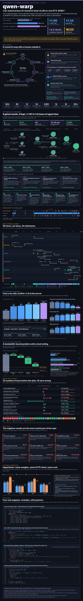

# qwen-warp

A fast single-sequence decode engine for **Swift-1.5-Qwen3.8-27B INT4** (W4A16 g128 + the checkpoint's MTP head) on **one RTX 3090** (sm_86, batch size 1), with an OpenAI-compatible server, a CPU reference oracle, a harness-gated autonomous optimisation campaign and a log of every pre-registered experiment, including the negative ones.

> Engine as of research-repo commit e59f394 (research repo `e59f3948b4dd913d7edccfb339c2bb89d471e5b5`). Program poster: [docs/infographic.svg](docs/infographic.svg) (PNG: [docs/infographic.png](docs/infographic.png)); interactive history of the program: [docs/history.html](docs/history.html) (open locally; needs `infographic.svg` and `data.json` next to it).
> **Unofficial.** Not affiliated with, endorsed by or derived from work of Alibaba or the Qwen team. The model weights are **not** included (see [Requirements](#how-to-run)).
> Most of this work was done by AI coding agents under human direction. Every experiment froze a written prediction before its first measurement; misses and dead ends are kept in the logs.
> Pointers such as `topics/...`, `papers/...` or `vendor/...` inside `docs/` and `experiments/` refer to the private research workspace this repo was exported from; they are not part of this release.



## What it is

A CUDA decode engine, **not** a persistent megakernel: a 64-layer step is a set of fused kernels captured in one CUDA graph (experiment E1 found a persistent kernel worth only +2.5% over per-op graphs). On top of it sits exact speculative decoding: the checkpoint's MTP layer drafts a chain of tokens (k = 3 by default), an exact prompt-lookup tail adds up to 4 more, one graph per cycle verifies up to 8 rows, accepts on device and rolls the DeltaNet state back. Greedy output equals plain greedy decode up to documented rounding near-ties; sampling (temperature / top-k / top-p) uses exact speculative sampling, checked by chi-square tests. Details: [docs/ENGINE.md](docs/ENGINE.md), [docs/OVERVIEW.md](docs/OVERVIEW.md), [engine/BENCH.md](engine/BENCH.md).

## Results

Decode tok/s, greedy, 384 new tokens, bf16 KV unless noted, prefill excluded (the E0 definition `384 / (t(385) - t(1))`). Prompts: E0 = code / prose / math of ~33 tokens plus an ~8K-token summarisation prompt; one prompt per class, so acceptance is per prompt, not a corpus average.

| system (source) | code | prose | math | 8K ctx |
|---|---|---|---|---|
| stock vLLM 0.30, no speculation (`experiments/2026-10-30-vllm-swift-int4-bs1-baseline`) | 46.8 | 46.7 | 46.8 | 45.9 |
| stock vLLM 0.30, MTP k=3, fp8 KV (same) | 96.4 | 63.0 | 93.5 | 75.5 |
| engine K4: MTP k=3, bf16 lm_head ([engine/BENCH.md](engine/BENCH.md) K4) | 145.0 | 94.7 | 143.0 | 115.4 |
| engine K9: k=3, int4 lm_head + exact bf16 rescoring (BENCH.md K9) | 167.8 | 107.4 | 165.5 | 151.9 |
| engine K11: k=3 chain + prompt-lookup tail, m=3 (BENCH.md K11, E0 table) | 167.9 | 107.5 | 166.9 | 131.5 |
| campaign winner m3, campaign harness (dev x1.106, held-out x1.098, plain x1.052, gate verdict x1.107); port to the repo and server-level verification pending | not a tok/s result: ratios vs the committed engine baseline inside the harness, see below | | | |

The 8K prompt is rebuilt from a changing set of notes, so it is **not the same text** in every row (K11's own base run on its text is 134.2 tok/s vs 151.9 for K9's); compare only within a row of one source. Plain engine decode is 55.2 tok/s (18.105 ms/step, BENCH.md K9) vs 46.8 for vLLM. The tail is neutral on prompts with nothing to copy (K11 E0 ratios x0.98-1.02).

Copy-heavy work (engine-direct A/B in one process, [experiments/2026-11-01-pld-tail-engine](experiments/2026-11-01-pld-tail-engine), BENCH.md K11; 32 tasks run to their canonical greedy length; base = k=3 cycles of the same build):

| E6 class (tasks) | base -> k=3 + tail tok/s | ratio [95% CI] |
|---|---|---|
| a code edits (8) / b log extraction (6) / c agent turns (6) | 172.8 -> 240.1 / 173.4 -> 230.5 / 185.8 -> 271.5 | x1.389 [1.23, 1.59] / x1.329 [1.17, 1.47] / x1.461 [1.34, 1.52] |
| a-c pooled (20) | 175.4 -> 242.3 | x1.381 [1.29, 1.49] (T=1 sampling x1.356) |
| d prose (6) / e math (6) | 109.9 -> 111.4 / 166.3 -> 178.2 | x1.014 [0.98, 1.05] / x1.072 [1.05, 1.10] |

HTTP server vs stock `vllm serve`, same client, E0 prompts ([server/README.md](server/README.md) and BENCH.md K8, measured with the **bf16 lm_head** before K9; the int4 head later gave +10% direct-engine, the HTTP table was not re-measured): decode 152.2 / 96.1 / 149.0 / 122.1 vs 96.6 / 64.4 / 94.8 / 74.1 tok/s (x1.58 / 1.49 / 1.57 / 1.65). Short-prompt TTFT through the server after K10: 34 / 38 / 47 / 75 / 128 ms at 8 / 20 / 40 / 64 / 128 prompt tokens (stock vLLM ~96 ms at ~30 tokens); 8K prompt 3.94 s vs 4.35 s (K8). Multi-turn resume from a DeltaNet snapshot: 240 ms vs 912 ms cold on turn 2.

Deeper MTP chains ([experiments/2026-11-01-mtp-chain-depth-sweep](experiments/2026-11-01-mtp-chain-depth-sweep), measured on a private patched copy of the library, **not in the shipped engine**): vs k=3, k=4 is never worse than x0.996 on any class and gives E0 code x1.12, math x1.11, E6 a / b / c x1.14 / 1.17 / 1.20; k=7 reaches x1.35 / 1.41 / 1.57 on E6 a / b / c; prose loses beyond k=4 (E0 prose x0.96 at k=5, x0.85 at k=7).

**Caveats.** One machine, one card, power limit 350 W (the card drew ~320-330 W at SM 1.5-1.7 GHz while decoding). The engine uses bf16 KV, stock vLLM fp8 KV. Rows come from different sessions on different days. All numbers are greedy unless stated; medians of 3 reps (spread usually < 0.5%) except where noted. The E6 tail policy was tuned on E6 classes a-c, so those ratios are in-sample (E6's held-out cross-validation gave x1.15). Stock vLLM was not run on E6.

**m3.** The campaign's best kept build is a merge of five kept changes (lazy rank-1 DeltaNet snapshots, a tile-contiguous W4 weight layout, a leaner W4 GEMV unpacking loop, a shorter DeltaNet prologue, a smaller register footprint of the in_proj_a|b kernel); it passed the harness's teacher-forced correctness check. The ratios above are what the harness measured against the pristine K11 engine; the hand port into `engine/` and a server-level benchmark are still pending, so no tok/s number is claimed for it.

## What is novel

- **Lazy rank-1 DeltaNet rollback.** A verify step of T rows normally writes T fp32 state snapshots (3.15 MB per layer each) of which only one is ever read. The campaign's `verify` lineage instead stores, per row, the rank-1 update of the recurrence `S_t = g_t * S_{t-1} + d_t (x) k_t`, and replays only the accepted rows lazily against the last full state. Found by the autonomous campaign (ledger headline: "DeltaNet verify steps store tiny rank-1 updates instead of full state snapshots, replayed lazily"); part of m3, not of the K11 numbers above. See [campaign/README.md](campaign/README.md) and the trace in [dashboard/](dashboard/).
- **MTP chain + exact prompt-lookup tail with exact speculative sampling** (K7, K11): sampled drafts, tail tokens proposed as point masses, residual sampling at rejection; kernel-level 2e6-cycle and end-to-end chi-square tests pass and the broken variants fail them ([experiments/2026-10-31-spec-sampling-exactness](experiments/2026-10-31-spec-sampling-exactness)).
- **int4 lm_head with exact bf16 rescoring of the top candidates** (K9): approximate logits from an int4 copy of the head, exact bf16 logits for the top 16 (64 when sampling); the bf16 top-1 was inside the candidate set at 19,976 / 19,976 positions and the argmax differed from the bf16 head at a single exact fp32 tie; plain step 20.15 -> 18.105 ms ([experiments/2026-10-31-lm-head-quant-engine](experiments/2026-10-31-lm-head-quant-engine)).
- **W4 tile-contiguous GEMV.** [engine/GEMV_LOG.md](engine/GEMV_LOG.md) records every attempt and why most failed; its measured remaining lever (#10, 1 KB contiguous warp units, -0.21 ms at T=1) was implemented by the campaign's `gemv` lineage and is part of m3.
- **A harness-gated autonomous campaign** ([campaign/](campaign/)): agents edit private copies of the engine and call `campaign try`; a harness they cannot edit decides keep / revert with paired pristine controls, a hidden held-out workload, a plain-decode guard and a calibrated teacher-forced correctness check, and its own mechanics tests with deliberately broken engines. It kept 9 rounds (6 single changes, 3 merges); the last merge is the winner m3 (trace in [dashboard/](dashboard/)). Honest limits are listed at the end of its README.
- **Pre-registered experiments** ([experiments/](experiments/)): 13 folders with the prediction committed before the first run, including many misses.

## What did not work

- Persistent kernel: +2.5% over the best per-op graph, below the 5% kill criterion ([E1](experiments/2026-10-30-w4-stream-persistence-vs-graph)); PDL is impossible on sm_86 (same experiment). The fused-phases dataflow experiment was cancelled by the human before any timed result ([experiments/2026-10-30-dataflow-fused-phases](experiments/2026-10-30-dataflow-fused-phases)).
- Attention-pointer and hidden-state kNN drafts add nothing over the exact tail: pointer x0.965, kNN x0.880, best-of x1.000 on E6 a-c ([experiments/2026-11-01-kv-pointer-draft-potential](experiments/2026-11-01-kv-pointer-draft-potential)).
- Fusing RMSNorm into the GEMV prologue: +5.3 us per GEMV, 21.47 vs 20.93 ms/step (BENCH.md K3). Overlapping the prefill dequant with the GEMM on a second stream: no gain (K10). An adaptive tail width: lost to always following the proposer (K11).
- int8 lm_head without exact rescoring misses the top-1 gate (99.19% vs 99.5% needed; int4 93-95%) ([experiments/2026-10-31-lm-head-quantisation-quality](experiments/2026-10-31-lm-head-quantisation-quality)).
- **Retraction:** K5's claim that the rewritten GEMV was bit-identical is false (BENCH.md "K7 follow-up"): a few outputs differ by one bf16 ulp and the 64 layers amplify that to the size of the T=1 vs T=4 noise.
- Parallel agents on one GPU: other tenants' runs add noise and lease contention cut the chain-depth sweep short, so its tail interaction, sampling and online gate were never run; the confidence gate is only modelled.

## Comparison with stock vLLM and HyperQwen

Stock vLLM 0.30 numbers are in the table above. HyperQwen (an Apache-2.0 vLLM 0.30 patch stack) was run **only as a comparison target**, unmodified, from its public container image `ghcr.io/syv-ai/hyperqwen`, on our weights, same client, same card (350 W), n = 2 interleaved rounds ([experiments/2026-11-01-hyperqwen-vs-swift-mk](experiments/2026-11-01-hyperqwen-vs-swift-mk)). HTTP greedy decode tok/s, swift-mk (k=3 + tail) / HyperQwen MTP k=4 / HyperQwen DFlash2 (7-token block drafter):

| | code | prose | math | 8K |
|---|---|---|---|---|
| swift-mk / HQ MTP / HQ DFlash2 | 165.6 / 173.9 / **253.6** | 107.2 / 104.1 / 102.9 | 165.7 / 177.4 / **225.3** | 131.2 / 139.2 / 121.3 |

HyperQwen's DFlash2 drafter is clearly faster on code and math (x1.53 / x1.36 on E0, x1.14 on E6 a-c pooled, at the same ~22 ms step: 5.2-5.8 vs 3.5 tokens per step) and its pooled-slot design wins concurrency and context length, which we **did not measure** (its server held an 85k-token KV pool vs our 28,672 bf16 limit). swift-mk wins TTFT (39 vs 53-56 ms at 20 tokens, 3.9 vs 4.2 s at 8K) and exactness: our greedy output is deterministic across rounds (30/30, 32/32) and uses a rescored bf16 head, while HyperQwen's greedy output matched ours on only 7 of 30 prompts over 128 tokens (different numerics, not a correctness verdict on either). Its drafter and heads are base-model artefacts reused on the fine-tune, so its numbers may be a lower bound; its published 250 W setting was not tested.

## How to run

**Requirements.** RTX 3090 (sm_86; nothing else is tested), CUDA toolkit with `nvcc` (the engine was built with CUDA 13.0, `-arch=sm_86`), a Python env with `torch`, `transformers` 5.18 (oracle checks) and **vLLM 0.30** (server; the fast prefill also uses `fla` and `vllm_flash_attn`, BENCH.md K6). Download the INT4 checkpoint yourself: the model card lists it as `ukisai/Swift-1.5-Qwen3.8-27b-INT4` (derived from [ukisai/Swift-1.5-Qwen3.8-27b](https://huggingface.co/ukisai/Swift-1.5-Qwen3.8-27b)); it is compressed-tensors W4A16, group 128, with bf16 embed / lm_head / MTP. It is **not redistributed here** and has its own licence (Swift Open License 1.0 per its model card). The scripts expect it at `~/models/swift-1.5-int4`.

**Paths.** Scripts and docs were written in a workspace where the Python was `~/llm-lab/venv/bin/python`; substitute your own interpreter (`PY` below). The oracle dumps used by the parity tests live in `~/llm-lab/swift-ref/{fp32,bf16}/` and are produced by `oracle/dump_ref.py`. The 8K benchmark prompt is built from `topics/*.md` of the private workspace; run `bench_spec.py` from the repo root with your own markdown in `topics/`, or leave `long8k` out. Some tests (`test_pld.py`) read result files of the experiments.

```bash
PY=python                                                   # your interpreter
make -C engine                                              # build/libswiftmk.so (`make core` = GEMV/norm ops only)
cd oracle && CUDA_VISIBLE_DEVICES="" $PY dump_ref.py --bf16-rounding   # CPU, ~7 min; also run without the flag for the fp32 dumps
cd engine && $PY tests/test_ops.py                          # unit tests of the core ops (GPU)
cd engine && $PY tests/test_e2e.py                          # engine vs oracle dumps: hidden states + greedy ids (PARITY.md)
cd engine && $PY tests/test_mtp.py                          # MTP packer, drafts, speculative greedy == plain greedy, rollback
cd engine && SMK_TMAX=8 $PY tests/test_pld_engine.py       # chain + prompt-lookup tail, T<=8 (exact greedy, rollback, sampling)
cd engine && $PY tests/test_sampling.py trials              # exact speculative sampling (chi-square); also e2e-run / e2e-ref / e2e-analyze
# also in engine/tests: test_headq.py test_prefill.py test_w4mm.py test_deltanet.py test_attn.py test_pld.py (CPU)
$PY engine/tests/bench_spec.py --prompts code,prose,math --ks 3 --reps 3   # decode tok/s (from the repo root)
cd engine && $PY tests/bench_pld.py --suite e0   # hybrid tail vs k=3 A/B; `bench_verify.py` = V(T), `bench_e2e.py` = plain decode
$PY server/serve.py --port 8000                             # OpenAI server, defaults: bf16 KV, k=3, --prompt-lookup auto, --max-model-len 28672
curl localhost:8000/v1/chat/completions -H 'Content-Type: application/json' \
  -d '{"model":"swift","messages":[{"role":"user","content":"Hello"}],"temperature":0,"max_tokens":64}'
$PY server/bench_server.py --url http://127.0.0.1:8000 --label swift-mk --model swift   # HTTP benchmark; smoke_test.py / runner_check.py = server tests
```

The tests were written to run one at a time on an otherwise idle GPU (they hold ~19-23 GiB). Full flag lists, the `vllm serve` plugin route and the VRAM table are in [server/README.md](server/README.md); the campaign's launch commands are in [campaign/README.md](campaign/README.md).

## Repo map

| path | what |
|---|---|
| [engine/](engine/) | CUDA sources `src/*.cu`, `include/`, Python driver (`engine.py`, `spec.py`, `prefill.py`, `pack*.py`), `tests/`, `Makefile`, [BENCH.md](engine/BENCH.md), [GEMV_LOG.md](engine/GEMV_LOG.md), [PARITY.md](engine/PARITY.md), [MTP_PARITY.md](engine/MTP_PARITY.md), [PREFILL_PARITY.md](engine/PREFILL_PARITY.md) |
| [server/](server/) | OpenAI-compatible server (vLLM's own frontend on an in-process engine core), benchmarks, smoke tests |
| [oracle/](oracle/) | CPU torch reference of the model and MTP head, checked against HF transformers |
| [campaign/](campaign/) | harness-gated autonomous optimisation campaign (config, adapters, mechanics tests) |
| [dashboard/](dashboard/) | `gen.py` + `index.html`: a self-contained trace of the engine program (git log, experiments, attempts, campaign) |
| [docs/](docs/) | [ENGINE.md](docs/ENGINE.md) kernel contract, [OVERVIEW.md](docs/OVERVIEW.md), [PROGRAM.md](docs/PROGRAM.md) (program file with dated attempts) |
| [experiments/](experiments/) | 13 pre-registered experiments, `experiments/<date>-<slug>/README.md` each |
| [related-work/](related-work/) | reading notes: open-jet, tpu-megakernels, bonsai-turbo, megakernels-vs-cuda-graphs, pdl-megakernel-reconstruction, lucebox, MegaQwen, Megakernels |

## Limitations

Single sequence only (requests are served FIFO; no batching, no concurrency). No logprobs, penalties, `min_p`, structured output, multimodal input or LoRA (rejected with HTTP 400; list in [server/README.md](server/README.md)); `top_k` is clamped to 64. sm_86 only, tested on a single power-capped 3090. Context is VRAM-bound: with the default int4 head, bf16 KV reaches 36,864 tokens (measured maximum) and fp8 KV 65,536 without the prompt-lookup tail; the tail's 9-slot DeltaNet ring costs 0.62 GiB, so with it 28,672 (bf16) / 53,248 (fp8); the model's 262,144 cannot be served on this card. Prompts of 240-600 tokens still use the slower dequant + cuBLAS prefill path. Numbers are from one machine and one card; the OpenAI server is minimal, and multi-turn snapshot reuse keeps one conversation lineage.

## Roadmap

- Make a deeper MTP chain (k = 4 or more) the default: k = 4 never lost in the depth sweep; the shipped engine is capped at k = 3 + tail.
- A cost-aware verify width / confidence gate (only modelled so far, never run online).
- Tree verification for DeltaNet hybrids, using the rank-1 log.
- A DFlash-style one-pass block drafter in the engine (HyperQwen's gap on code and math).
- 3-bit weights; a VRAM diet for long context (the bf16 embed and rescoring head cost ~2.5 GB each); multi-sequence decoding.
- Port campaign winner m3 into `engine/` and re-measure the HTTP server.

## License, disclaimer, acknowledgements

MIT, see [LICENSE](LICENSE); third-party credits in [NOTICE](NOTICE). This is an independent research project: no affiliation with Alibaba, the Qwen team or UkisAI, and no warranty. Model weights are not included and carry their own licence.

Thanks to: [bonsai-turbo](related-work/bonsai-turbo.md) and [lucebox](related-work/lucebox.md) (Apache-2.0; design references, credits in [NOTICE](NOTICE)); [open-jet](related-work/open-jet.md) (AGPL-3.0, read only as a design reference, no code copied); [megakernels-vs-cuda-graphs](related-work/megakernels-vs-cuda-graphs.md), [tpu-megakernels](related-work/tpu-megakernels.md), [MegaQwen](related-work/MegaQwen.md) and [Megakernels](related-work/Megakernels.md) for the persistent-kernel background; vLLM (frontend, reference decode, fla and FlashAttention kernels); HuggingFace transformers (oracle semantics); HyperQwen (comparison target).
