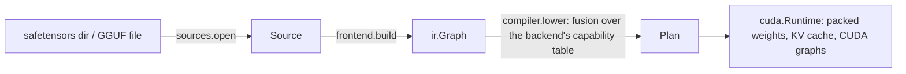

# warpc

An experimental compiler for dense decoder-only language models. It reads a Hugging Face safetensors checkpoint or a GGUF
file, builds a graph, fuses it into the kernels a backend declares it can run, and replays the result as CUDA graphs. It is
how this repository explores supporting models beyond the one the engine is written for; it shares no code with `engine/`.



## Use

```python
import warpc

model = warpc.compile("Qwen3-0.6B-Q4_0.gguf", ctx_max=4096)  # or an HF checkpoint directory
tokens = model.generate([785, 6722, 315, 9625, 374], max_new_tokens=24)
```

Token ids in, token ids out (no tokenizer). `prefill`, `step`, `decode`, `logits` and `reset` give step-level control.

## Scope

- Families: Llama, Mistral, Qwen3. Anything else raises `UnsupportedModel` naming the setting (projection biases, sliding
  window, rope scaling, ...).
- GGUF: F32, F16, BF16, Q8_0, Q4_0 and Q4_1 are decoded by warpc, bit-identical to ggml; other block formats go through the
  `gguf` package; IQ formats are rejected. Q4_0 linears stay in their 18-byte blocks on the device and run a fused
  dequantising GEMV; every other weight is bf16.
- KV cache: `bf16`, `k8v8`, `k8v8w`, `k8v4w`.
- Greedy decode of one sequence; prompt steps of up to 8 rows.
- Built and measured on an RTX 3090 (sm_86). Kernels compile for the GPU present; the fusion cost model uses the 3090's
  numbers.

## Layout

| Module | Role |
|---|---|
| `sources/` | `open(path)`: safetensors and GGUF readers behind one `Source` (HF tensor names, `ModelConfig`) |
| `frontend.py` | `Source` to `ir.Graph` |
| `ir/` | the graph and its op vocabulary |
| `reference.py` | pure-torch interpreter of a graph, the test oracle |
| `kvcache.py` | KV formats: sizes and reference quantisation |
| `compiler/` | target-independent: the fusion pass over a capability table, lowering to a `Plan` |
| `cuda/` | the CUDA backend: capability table, launchers, weight packing, runtime, kernels |
| `model.py` | `compile()` and `Model` |

The kernel library is built with nvcc on first use and cached by source digest and GPU architecture.

## Setup and tests

From the repository root:

```bash
uv sync --all-packages
uv run --package warpc python warpc/tests/test_sources.py   # CPU
uv run --package warpc python warpc/tests/test_frontend.py  # CPU
uv run --package warpc python warpc/tests/test_compiler.py  # CPU
uv run --package warpc python warpc/tests/test_cuda.py      # GPU and nvcc
```

| Variable | Effect |
|---|---|
| `NVCC`, `CUDA_HOME` | where nvcc is (default: `nvcc` on `PATH`) |
| `WARPC_CACHE_DIR` | kernel build cache (default `$XDG_CACHE_HOME/warpc`, else `~/.cache/warpc`) |
| `LLAMA_CPP_DIR` | a llama.cpp checkout: enables the ggml bit-identity test |
| `WARPC_TEST_GGUF` | a GGUF file: enables the real-file tests |

A test whose prerequisite is missing prints `skip` with the reason.

## Measured

RTX 3090, Qwen3-0.6B GGUF files, greedy decode of 256 tokens after a short prompt, median of 5, `ctx_max` 512:

| | tok/s |
|---|---|
| warpc, Q4_0 file | 706 |
| llama.cpp `llama-server`, same Q4_0 file | 568 |
| warpc, BF16 file | 588 |

warpc: `uv run --package warpc python warpc/tests/bench.py FILE --ctx-max 512`. llama.cpp: `llama-server -m FILE -ngl 99
-c 512`, `/completion` with `n_predict` 256 and `temperature` 0, `timings.predicted_per_second`. On the Q4_0 file the 24
greedy tokens after "The capital of France is" equal llama.cpp's (`test_cuda.py`).
