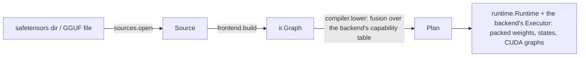

# warpc

An experimental compiler for dense decoder-only language models. It reads a Hugging Face safetensors checkpoint or a GGUF
file, builds a graph, fuses it into the kernels a backend declares it can run, and replays the result as CUDA graphs. It is
how this repository explores supporting models beyond the one the engine is written for; it shares no code with `engine/`.



## Use

```python
import warpc

model = warpc.compile("Qwen3-0.6B-Q4_0.gguf", ctx_max=4096)  # or an HF checkpoint directory
tokens = model.generate([785, 6722, 315, 9625, 374], max_new_tokens=24)
```

Token ids in, token ids out (no tokenizer). `prefill`, `step`, `decode`, `logits` and `reset` give step-level control.
`compile(..., backend=...)` lowers onto another backend (default `CudaBackend()`).

## Scope

- Families: Llama, Mistral, Qwen3. Anything else raises `UnsupportedModel` naming the setting (projection biases, sliding
  window, rope scaling, ...).
- Qwen3.5 (Gated DeltaNet + gated attention hybrids, including compressed-tensors W4A16 group-128 checkpoints): graph and
  reference interpreter; the CUDA table refuses its ops with a `LoweringError` that lists them. The `swiftmk` backend runs
  the 27B checkpoint on the hand engine's kernels (below).
- GGUF: F32, F16, BF16, Q8_0, Q4_0 and Q4_1 are decoded by warpc, bit-identical to ggml; other block formats go through the
  `gguf` package; IQ formats are rejected. Q4_0 linears stay in their 18-byte blocks on the device and run a fused
  dequantising GEMV; every other weight is bf16.
- KV cache: `bf16`, `k8v8`, `k8v8w`, `k8v4w`, `int4_rot` (the hand engine's 4-bit format, bit-identical bytes at head dim
  256); `fp8` (the checkpoint's per-layer scales) in the reference only.
- Greedy decode of one sequence; prompt steps of up to 8 rows.
- Built and measured on an RTX 3090 (sm_86). Kernels compile for the GPU present; the fusion cost model uses the 3090's
  numbers.

## Layout

| Module | Role |
|---|---|
| `sources/` | `open(path)`: safetensors (float and W4G128) and GGUF readers behind one `Source` (HF tensor names, `ModelConfig`) |
| `frontend/` | `Source` to `ir.Graph`, one module per family (`dense`, `qwen35`) over shared helpers |
| `ir/` | the graph and its op vocabulary |
| `reference.py` | pure-torch interpreter of a graph, the test oracle |
| `kvcache.py` | KV formats: sizes and reference quantisation |
| `compiler/` | target-independent: the fusion pass over a capability table, lowering to a `Plan`; the `Backend` protocol |
| `runtime.py` | `Runtime`: buffers, states, CUDA graphs, position and token feedback; the `Executor` protocol a backend implements |
| `cuda/` | the CUDA backend: capability table, executor (launchers, weight packing), kernels |
| `swiftmk/` | the `swiftmk` backend: the hand engine's kernel library behind a capability table (ctypes binding, packing) |
| `model.py` | `compile()` and `Model` |

The kernel library is built with nvcc on first use and cached by source digest and GPU architecture.

## Setup and tests

From the repository root:

```bash
uv sync --all-packages
uv run --package warpc python warpc/tests/test_sources.py   # CPU
uv run --package warpc python warpc/tests/test_frontend.py  # CPU
uv run --package warpc python warpc/tests/test_compiler.py  # CPU
uv run --package warpc python warpc/tests/test_kvcache.py   # KV formats
uv run --package warpc python warpc/tests/test_cuda.py      # GPU and nvcc
uv run --package warpc python warpc/tests/test_swiftmk.py   # GPU, $WARPC_SWIFTMK_LIB
```

| Variable | Effect |
|---|---|
| `NVCC`, `CUDA_HOME` | where nvcc is (default: `nvcc` on `PATH`) |
| `WARPC_CACHE_DIR` | kernel build cache (default `$XDG_CACHE_HOME/warpc`, else `~/.cache/warpc`) |
| `LLAMA_CPP_DIR` | a llama.cpp checkout: enables the ggml bit-identity test |
| `WARPC_TEST_GGUF` | a GGUF file: enables the real-file tests |
| `WARPC_SWIFTMK_LIB` | `engine/build/libswiftmk.so` (built by `make engine`): the `swiftmk` backend's library and tests, and the `int4_rot` byte-identity test against the engine |
| `WARPC_TEST_SWIFT27` | the Qwen3.5 27B checkpoint directory: its graph (`test_frontend.py`), lowering onto `swiftmk` (`test_swiftmk.py`), the reference on the GPU (`test_cuda.py`) |

A test whose prerequisite is missing prints `skip` with the reason.

## The swiftmk backend

`warpc.compile(path, rows_max=8, backend=SwiftmkBackend(head="bf16" | "int4_refine"))` lowers the Qwen3.5 27B graph onto
the kernels the hand engine exports from `libswiftmk.so`, loaded from `$WARPC_SWIFTMK_LIB` only (no default path, no
shared code). The library is refused when its workspace and KV-cache size queries disagree with the layouts the binding
was written against, and its sha256 is recorded. Each capability carries its kernel's hard-coded limits (hidden 5120,
24 / 4 attention heads of 256, partial rope over 64 dims at theta 1e7, 48 DeltaNet heads, at most 8 rows), so any other
graph fails at lowering with the limit named. The plan is the hand engine's step: 499 launches, the in_proj_a|b GEMV on a
side stream beside the qkv|z GEMV. KV caches: `bf16`, `fp8` (checkpoint scales), `int4_rot`.

`warpc/tools/compare27.py` runs warpc and the hand engine (`warpc/tools/swift_worker.py`) one after the other on the same
library file, prompt ids, `ctx_max` and 8-row prompt steps, and checks all 256 greedy ids and the fp32 logits of the
first 16 head steps for equality. `warpc/tools/bench.py` measures warpc, the hand engine (`swift-engine`) and vLLM on long
prompts (`--prompt-files`, `--prompt-len`).

## Measured

Every model in [`tools/models.toml`](tools/models.toml) (Qwen3 0.6B to 8B, Llama 3.2 1B and 3B, Llama 3.1 8B, Mistral 7B
v0.3), as the HF bf16 checkpoint and as GGUF Q4_0 and Q8_0 files (Q8_0 up to 4B); the list pins each repository's
revision and names the GGUF repository of each model. RTX 3090, vLLM 0.34.0 (this workspace's lock), llama.cpp b8889. To
reproduce, from the repository root:

```bash
export WARPC_MODELS=/path/to/models   # the whole list takes 101 GB
uv run --package warpc python warpc/tools/fetch.py [MODEL ...]   # resumable, skips what is there; --dry-run lists sizes
uv run --package warpc python warpc/tools/matrix.py [MODEL ...] [--steps check,warpc,llama-server,vllm] [--formats bf16,Q4_0,Q8_0]
uv run --package warpc python warpc/tools/matrix.py --table
```

`LLAMA_SERVER` names the `llama-server` binary when it is not on `PATH`. `matrix.py` runs each measurement as its own
process (`tools/check.py`, `tools/bench.py`; vLLM always in a process of its own, `tools/vllm_worker.py`) and merges the
results into `$WARPC_MODELS/matrix.json`; a failing measurement is recorded with its error. The table below is
`matrix.py --table`, measured one model and one `--steps` group at a time.

- top-1, rel. L2 (`check.py`): four fixed text prompts (117 to 132 positions, depending on the tokenizer) fed to warpc one
  step per token; the next-token logits at every position against transformers in bf16 for HF rows and against
  `warpc.reference` with fp32 activations on the same file for GGUF rows. rel. L2 is the mean over positions of
  |warpc - oracle| / |oracle|.
- greedy: the first 64 tokens of each prompt's greedy continuation; per prompt, how many lead the same as vLLM's (HF rows)
  or llama.cpp's (GGUF rows), and the largest margin of warpc's logit for its own token over the baseline's where they
  part.
- tok/s (`bench.py`): single stream, the same 5-token prompt, 256 greedy tokens with end of sequence ignored, median of 5
  after a warm-up round, prefill not counted, at `ctx_max` 512 and 4096. warpc: wall time of `Model.decode(256)`.
  llama.cpp: `llama-server -m FILE -ngl 99 -c CTX -np 1`, `/completion`'s `timings.predicted_per_second`. vLLM: offline
  `LLM` with its defaults (torch.compile, CUDA graphs), `gpu_memory_utilization` 0.85; the rate is
  (tokens - 1) / (`last_token_ts` - `first_token_ts`) from `RequestOutput.metrics`, the engine core's timestamps of the
  first and last generated token.

| model | format | top-1 | rel. L2 | greedy = vLLM 0.34.0 | greedy = llama.cpp | warpc 512 | warpc 4096 | llama.cpp 512 | llama.cpp 4096 | vLLM 0.34.0 512 | vLLM 0.34.0 4096 |
| --- | --- | --- | --- | --- | --- | --- | --- | --- | --- | --- | --- |
| Qwen3-0.6B | HF bf16 | 97.4% | 0.0244 | 9/64 13/64 12/64 64/64, margin ≤ 0.26 | – | 585 | 577 | – | – | 424 | 412 |
| Qwen3-0.6B | GGUF Q4_0 | 98.3% | 0.0193 | – | 0/64 1/64 6/64 16/64, margin ≤ 0.67 | 699 | 689 | 563 | 559 | [1] | [1] |
| Qwen3-0.6B | GGUF Q8_0 | 99.1% | 0.0170 | – | 14/64 12/64 64/64 64/64, margin ≤ 0.16 | 585 | 577 | 498 | 496 | [1] | [1] |
| Qwen3-1.7B | HF bf16 | 97.4% | 0.0273 | 64/64 15/64 54/64 50/64, margin ≤ 0.09 | – | 231 | 230 | – | – | 194 | 191 |
| Qwen3-1.7B | GGUF Q4_0 | 100.0% | 0.0292 | – | 7/64 13/64 54/64 61/64, margin ≤ 0.35 | 334 | 331 | 390 | 390 | [1] | [1] |
| Qwen3-1.7B | GGUF Q8_0 | 100.0% | 0.0398 | – | 13/64 10/64 27/64 64/64, margin ≤ 0.70 | 231 | 230 | 290 | 290 | [1] | [1] |
| Qwen3-4B | HF bf16 | 100.0% | 0.0297 | 64/64 40/64 64/64 64/64, margin ≤ 0.04 | – | 102 | 101 | – | – | 88 | 88 |
| Qwen3-4B | GGUF Q4_0 | 99.1% | 0.0237 | – | 13/64 64/64 21/64 64/64, margin ≤ 0.38 | 163 | 161 | 219 | 218 | [1] | [1] |
| Qwen3-4B | GGUF Q8_0 | 100.0% | 0.0255 | – | 17/64 34/64 0/64 64/64, margin ≤ 0.17 | 102 | 101 | 148 | 147 | [1] | [1] |
| Qwen3-8B | HF bf16 | 99.1% | 0.0208 | 56/64 64/64 19/64 64/64, margin ≤ 0.10 | – | 55 | 54 | – | – | 51 | 51 |
| Qwen3-8B | GGUF Q4_0 | 100.0% | 0.0144 | – | 64/64 64/64 18/64 64/64, margin ≤ 0.08 | 95 | 95 | 145 | 144 | [1] | [1] |
| Llama-3.2-1B-Instruct | HF bf16 | 98.3% | 0.0190 | 64/64 64/64 64/64 64/64 | – | 322 | 321 | – | – | 278 | 274 |
| Llama-3.2-1B-Instruct | GGUF Q4_0 | 99.2% | 0.0157 | – | 17/64 58/64 64/64 64/64, margin ≤ 0.35 | 460 | 459 | 598 | 597 | [1] | [1] |
| Llama-3.2-1B-Instruct | GGUF Q8_0 | 99.2% | 0.0145 | – | 32/64 64/64 64/64 64/64, margin ≤ 0.08 | 322 | 321 | 438 | 437 | [1] | [1] |
| Llama-3.2-3B-Instruct | HF bf16 | 99.2% | 0.0136 | 64/64 64/64 64/64 64/64 | – | 128 | 127 | – | – | 113 | 112 |
| Llama-3.2-3B-Instruct | GGUF Q4_0 | 100.0% | 0.0156 | – | 48/64 64/64 11/64 64/64, margin ≤ 0.18 | 210 | 209 | 284 | 284 | [1] | [1] |
| Llama-3.2-3B-Instruct | GGUF Q8_0 | 100.0% | 0.0151 | – | 64/64 39/64 64/64 64/64, margin ≤ 0.03 | 128 | 128 | 190 | 190 | [1] | [1] |
| Llama-3.1-8B-Instruct | HF bf16 | 100.0% | 0.0154 | 64/64 64/64 11/64 64/64, margin ≤ 0.03 | – | 56 | 56 | – | – | 53 | 53 |
| Llama-3.1-8B-Instruct | GGUF Q4_0 | 99.2% | 0.0128 | – | 64/64 8/64 64/64 30/64, margin ≤ 0.61 | 98 | 98 | 153 | 153 | [1] | [1] |
| Mistral-7B-Instruct-v0.3 | HF bf16 | 100.0% | 0.0057 | 64/64 64/64 64/64 21/64, margin ≤ 0.02 | – | 59 | 59 | – | – | 56 | 55 |
| Mistral-7B-Instruct-v0.3 | GGUF Q4_0 | 100.0% | 0.0044 | – | 64/64 64/64 64/64 64/64 | 110 | 109 | 165 | 165 | [1] | [1] |

[1] `RuntimeError: vLLM: huggingface_hub.errors.HFValidationError: Repo id must be in the form 'repo_name' or
'namespace/repo_name': 'MODEL'.` vLLM 0.34.0 has no GGUF loader: it takes the file (passed as `model`, with the HF
directory as `tokenizer` and `hf_config_path`) for a Hub repository id.

- Where greedy continuations part, warpc's own token leads the baseline's by at most 0.70 logits: near ties that rounding
  decides. The GGUF rows part from llama.cpp sooner than the bf16 rows from vLLM, which fits llama.cpp's quantised matrix
  products rounding the activations to 8 bits.
- bf16: warpc decodes 6 to 40% faster than vLLM (Llama-3.1-8B: 56 against 53 tok/s, about 15 GB of weights per token,
  850 GB/s).
- GGUF: llama.cpp is 1.17 to 1.56 times faster on every file but Qwen3-0.6B's, where warpc is 1.2 times faster. A Q8_0
  file runs as bf16 in warpc, at the bf16 checkpoint's speed. On a Q4_0 file the tensors in other formats are widened to
  bf16 (the Q6_K output or embedding matrix, a few Q4_1 matrices), and the fused Q4_0 GEMV streams far below the bf16
  path: Llama-3.1-8B reads about 5.3 GB per token at 98 tok/s, 520 GB/s.
- `ctx_max` 4096 costs warpc at most 1.5% against 512.

### Qwen3.5 27B against the hand engine

RTX 3090 (350 W limit), Swift-1.5-Qwen3.8-27B-INT4, swiftmk backend (bf16 head) against the hand engine
(`Engine(tmax=8, state_slots=1)`) and vLLM 0.34.0 (`--language-model-only`, max_model_len prompt + 512): tok/s of the
255 tokens after the first, the prompt cut from `engine/src/*.cu`, median of 5 rounds, median of two A/B visits:

| KV cache (bytes per token, 16 layers) | prompt | warpc | hand engine | vLLM 0.34.0 |
|---|---|---|---|---|
| bf16 (64 KiB) | 385 | 51.47 | 51.49 | 47.71 |
| bf16 (64 KiB) | 65,536 | 41.26 | 41.25 | 42.52 |
| fp8 (32 KiB) | 385 | 51.51 | 51.52 | 47.72 |
| fp8 (32 KiB) | 65,536 | 45.74 | 45.75 | 42.51 |
| int4_rot (16.5 KiB) | 385 | 51.21 | 51.17 | n/a |
| int4_rot (16.5 KiB) | 65,536 | 48.05 | 48.02 | n/a |

With the bf16 head and with the hand engine's int4 head, all 256 greedy ids and the fp32 logits of the first 16 steps
are equal to the hand engine's for every KV cache at 385- and 4,096-token prompts (`compare27.py`).
