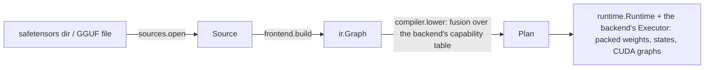

# warpc

An experimental compiler for dense decoder-only language models. It reads a Hugging Face safetensors checkpoint or a GGUF
file, builds a graph, fuses it into the kernels a backend declares it can run, and replays the result as CUDA graphs. It is
how this repository explores supporting models beyond the one the engine is written for; it shares no code with `engine/`.



## Use

```python
import warpc

model = warpc.compile("Qwen3-0.6B-Q4_0.gguf", ctx_max=4096)  # or an HF checkpoint directory
tokens = model.generate([785, 6722, 315, 9625, 374], max_new_tokens=24)
```

Token ids in, token ids out (no tokenizer). `append`, `step`, `decode`, `logits` and `reset` give step-level control.
`compile(..., backend=...)` lowers onto another backend (default `CudaBackend()`).

## Scope

- Families: Llama, Mistral, Qwen3. Anything else raises `UnsupportedModel` naming the setting (projection biases, sliding
  window, rope scaling, ...).
- Qwen3.5 (Gated DeltaNet + gated attention hybrids, including compressed-tensors W4A16 group-128 checkpoints): graph,
  reference interpreter and the CUDA kernels for the 27B INT4 checkpoint with a `bf16` or `int4_rot` KV cache; the
  `swiftmk` backend runs it on the hand engine's kernels, and the `fp8` KV cache only there (below).
- Gemma 4 E2B (the text decoder: sliding-window and global attention layers with their own head dims, KV sharing, per-layer
  input embeddings, sandwich norms, softcapped logits; bf16 weights) on the CUDA backend, bf16 KV only. The 31B / 26B-A4B
  variants (`attention_k_eq_v`, MoE) and every other Gemma 4 setting the graph cannot reproduce raise `UnsupportedModel`.
- Inkling-2-Mini (`inkling2_loop`: 24 layers run as 48 visits, block attention residuals, relative-bias attention with sinks
  and a sliding window, short convolutions, a 128-expert W4G128 MoE): compiled and run on the CUDA backend from the INT4
  checkpoint, with the reference interpreter checked against the official implementation ([Inkling-2-Mini](#inkling-2-mini)).
- GGUF: F32, F16, BF16, Q8_0, Q4_0 and Q4_1 are decoded by warpc, bit-identical to ggml; other block formats go through the
  `gguf` package; IQ formats are rejected. Q4_0 linears stay in their 18-byte blocks on the device and run a fused
  dequantising GEMV; every other weight is bf16.
- KV cache: `bf16`, `k8v8`, `k8v8w`, `k8v4w`, `int4_rot` (the hand engine's 4-bit format, bit-identical bytes at head dim
  256); `fp8` (the checkpoint's per-layer scales) in the reference only.
- Greedy decode of one sequence; prompt steps of up to 8 rows, or with `compile(window_rows=N)` on the swiftmk backend
  windows of up to 4,096 rows ([Long-context agent loops](#long-context-agent-loops)).
- Qwen3.5 27B only: greedy speculation with the checkpoint's MTP head, `compile(speculate=3)`
  ([MTP speculative decoding](#mtp-speculative-decoding)).
- Built and measured on an RTX 3090 (sm_86). Kernels compile for the GPU present; the fusion cost model uses the 3090's
  numbers.

## Layout

| Module | Role |
|---|---|
| `sources/` | `open(path)`: safetensors (float and W4G128) and GGUF readers behind one `Source` (HF tensor names, `ModelConfig`) |
| `frontend/` | `Source` to `ir.Graph`, one module per family (`dense`, `qwen35`, `gemma4`, `inkling`) over shared helpers |
| `ir/` | the graph and its op vocabulary |
| `reference.py` | pure-torch interpreter of a graph, the test oracle |
| `kvcache.py` | KV formats: sizes and reference quantisation |
| `compiler/` | target-independent: the fusion pass over a capability table, lowering to a `Plan`; the `Backend` protocol |
| `runtime.py` | `Runtime`: buffers, states, CUDA graphs, position and token feedback; the `Executor` protocol a backend implements |
| `cuda/` | the CUDA backend: capability table, executor (launchers, weight packing), kernels; `cuda/inkling/` holds the four Inkling kernel families, one module per Qwen3.5 kernel family (`hybrid`, `w4`, `deltanet`, `attn_gated`, `head_refine`) |
| `swiftmk/` | the `swiftmk` backend: the hand engine's kernel library behind a capability table (ctypes binding, packing); `swiftmk/window.py`: the window prefill caps and launchers |
| `composite.py` | `CompositeBackend`: two backends behind one table, the primary's kernels preferred, each task run by its owner |
| `model.py` | `compile()` and `Model` |
| `speculate.py`, `memory.py` | `Speculator` (the MTP cycle program, rollback, snapshots, the `Decoder` of `compile(speculate=k)`), the pre-flight memory estimate (torch's cached-free device memory counts as free) |
| `prefix.py`, `windows.py`, `windowrt.py` | `PrefixCache` (snapshots, device lineage, pinned-host store), `plan_windows` (the prefill segmentation), `WindowVariant` (the eager window plan of a `Runtime`; keeps no reference back to it) |
| `pinned.py` | every pinned host allocation (host tables, snapshots, KV chunks): exact size, unpinned and unmapped when the last reference goes; `live_bytes()` |

The kernel library is built with nvcc on first use and cached by source digest and GPU architecture.

## Setup and tests

From the repository root:

```bash
uv sync --all-packages
uv run --package warpc python warpc/tests/test_sources.py   # CPU
uv run --package warpc python warpc/tests/test_frontend.py  # CPU
uv run --package warpc python warpc/tests/test_compiler.py  # CPU
uv run --package warpc python warpc/tests/test_kvcache.py   # KV formats
uv run --package warpc python warpc/tests/test_cuda.py      # GPU and nvcc
uv run --package warpc python warpc/tests/test_swiftmk.py   # GPU, $WARPC_SWIFTMK_LIB
uv run --package warpc python warpc/tests/test_gemma4.py        # Gemma 4: CPU, and the compiled tiny model on the GPU
uv run --package warpc python warpc/tests/test_gemma4_rows.py   # GPU: the Gemma row / GEMV kernels, one by one
uv run --package warpc python warpc/tests/test_gemma4_attn.py   # GPU: the attention kernels against the reference
uv run --package warpc python warpc/tests/test_inkling_res.py    # the Inkling kernel families, GPU and nvcc:
uv run --package warpc python warpc/tests/test_inkling_gemv.py   # attn_res / controllers / convolution, GEMVs and head,
uv run --package warpc python warpc/tests/test_inkling_attn.py   # attention, MoE (the CPU parts need no device)
uv run --package warpc python warpc/tests/test_inkling_moe.py
uv run --package warpc python warpc/tests/test_composite.py # CPU
uv run --package warpc python warpc/tests/test_stage2.py    # CPU, $WARPC_TEST_SWIFT27: the 27B lowers onto the CUDA kernels alone
# GPU, $WARPC_SWIFTMK_LIB: each family's kernel against the hand kernel (set WARPC_W4_SPEED, WARPC_ATTN_SPEED,
# WARPC_HEAD_SPEED for the speed rows)
uv run --package warpc python warpc/tests/test_hybrid.py    # norms, head, a|b
uv run --package warpc python warpc/tests/test_w4.py
uv run --package warpc python warpc/tests/test_deltanet.py
uv run --package warpc python warpc/tests/test_attn_gated.py
uv run --package warpc python warpc/tests/test_head_refine.py
uv run --package warpc python warpc/tests/test_prefix.py    # CPU: the prefix cache against a fake decoder
uv run --package warpc python warpc/tests/test_windows.py   # CPU: plan_windows against the hand engine's planner
uv run --package warpc python warpc/tests/test_window.py    # CPU, $WARPC_TEST_SWIFT27: the 27B lowers onto the window caps
uv run --package warpc python warpc/tests/test_longctx.py   # GPU, $WARPC_SWIFTMK_LIB, $WARPC_TEST_SWIFT27: resume == cold, models dropped and rebuilt (one process)
uv run --package warpc python warpc/tests/test_pinned.py    # GPU: pinned host memory of exact size, released by refcount
uv run --package warpc python warpc/tests/test_requantize.py  # CPU; GPU, $WARPC_SWIFTMK_LIB: the MTP head's packs == the hand packer's
uv run --package warpc python warpc/tests/test_glue.py        # GPU: the concat / select_row / take kernels
uv run --package warpc python warpc/tests/test_speculate.py   # GPU, $WARPC_SWIFTMK_LIB, $WARPC_TEST_SWIFT27: accept program, exactness, resume
```

| Variable | Effect |
|---|---|
| `NVCC`, `CUDA_HOME` | where nvcc is (default: `nvcc` on `PATH`) |
| `WARPC_CACHE_DIR` | kernel build cache (default `$XDG_CACHE_HOME/warpc`, else `~/.cache/warpc`) |
| `LLAMA_CPP_DIR` | a llama.cpp checkout: enables the ggml bit-identity test |
| `WARPC_TEST_GGUF` | a GGUF file: enables the real-file tests |
| `WARPC_SWIFTMK_LIB` | `engine/build/libswiftmk.so` (built by `make engine`): the `swiftmk` backend's library and tests, and the `int4_rot` byte-identity test against the engine |
| `WARPC_TEST_SWIFT27` | the Qwen3.5 27B checkpoint directory: its graph (`test_frontend.py`), lowering onto `swiftmk` (`test_swiftmk.py`), the reference on the GPU (`test_cuda.py`) |
| `WARPC_TEST_GEMMA4` | a Gemma 4 E2B text checkpoint directory: its header and graph (`test_gemma4.py`) |
| `WARPC_TEST_INKLING` | the Inkling-2-Mini W4G128 directory (with the `config.json` that `tools/inkling_w4_config.py` writes): its header test (`test_sources.py`), real layers in the MoE kernel test, the reference and the compiled model on the GPU (`test_cuda.py`; each needs the card alone, about 15 GB) |
| `WARPC_INKLING_QUALITY` | optional, `test_cuda.py`: a directory with the old tree's interpreter logit dumps `ref-{0..3}.pt` of the four quality texts; `test_inkling_reference_real` prints the agreement with them (no bound) |
| `WARPC_INKLING_REF_PYTHON` | the python (or venv) of an environment with transformers' official `inkling2_loop` (commit 046bdb8): the tiny-model oracle `tests/oracle/inkling_hf.py` (`test_frontend.py`) |

A test whose prerequisite is missing prints `skip` with the reason.

## The swiftmk backend

`warpc.compile(path, rows_max=8, backend=SwiftmkBackend(head="bf16" | "int4_refine"))` lowers the Qwen3.5 27B graph onto
the kernels the hand engine exports from `libswiftmk.so`, loaded from `$WARPC_SWIFTMK_LIB` only (no default path, no
shared code). The library is refused when its workspace and KV-cache size queries disagree with the layouts the binding
was written against, and its sha256 is recorded. Each capability carries its kernel's hard-coded limits (hidden 5120,
24 / 4 attention heads of 256, partial rope over 64 dims at theta 1e7, 48 DeltaNet heads, at most 8 rows), so any other
graph fails at lowering with the limit named. The plan is the hand engine's step: 499 launches, the in_proj_a|b GEMV on a
side stream beside the qkv|z GEMV. KV caches: `bf16`, `fp8` (checkpoint scales), `int4_rot`.

`warpc/tools/compare27.py` runs warpc and the hand engine (`warpc/tools/swift_worker.py`) one after the other on the same
library file, prompt ids, `ctx_max` and 8-row prompt steps, and checks all 256 greedy ids and the fp32 logits of the
first 16 head steps for equality. `warpc/tools/bench.py` measures warpc, the hand engine (`swift-engine`) and vLLM on long
prompts (`--prompt-files`, `--prompt-len`).

## MTP speculative decoding

`warpc.compile(path, ..., speculate=3)` loads the checkpoint's MTP head and returns a `Model` whose decoder is a
`Speculator`: greedy decode in which the head drafts k <= 3 tokens, the target verifies k + 1 rows in one step, the
accepted prefix stays and the rest is rolled back by not advancing. The head (`mtp.*`: `fc` and one full-attention layer,
re-quantised to W4G128 by `sources/requantize.py`, the hand engine's packer; the draft head is `lm_head` restricted to
the engine's 68,864-id draft vocabulary, shipped in `sources/data/`) is a second graph in the same IR with its own KV
state. It needs a backend whose DeltaNet keeps pending rows: the hand kernels do all model compute and
warpc owns the cycle (`CompositeBackend(CudaBackend("int4_refine"), SwiftmkBackend("int4_refine"), kernels=["g_select_row",
"g_take", "g_concat"])`, the three warpc data-movement kernels).

```python
GLUE = ["g_select_row", "g_take", "g_concat"]
backend = CompositeBackend(CudaBackend("int4_refine"), SwiftmkBackend("int4_refine", window=True), kernels=GLUE)
m = warpc.compile(
    path, ctx_max=131_072, kv="int4_rot", backend=backend, speculate=3, host_tables=True, window_rows=4096
)
first = m.append(ids, ends=plan_windows(ids))  # target prefill, the MTP pair of every row, the first drafts
out = [first, *m.decode(255, stop=[eos])]  # exactly 255 tokens, or up to the first stop id
snap = m.snapshot()  # the turn boundary: states, anchor, hidden row (179 MiB; the KV rows are positional)
m.append([m.decoder.anchor, *tool_ids])  # the next turn continues the cache, no re-prefill
m.restore(snap)  # back to the boundary (the KV rows below it must be this lineage's, else `kv_import`)
m.decoder.k = 1  # drafts per cycle, 0 = plain steps; m.decoder.stats: cycles, tokens, accepted drafts
```

One cycle is one captured CUDA graph (verify, accept, draft; the host launches 8 and reads the output ring once).
Acceptance, the clamp to the token budget and stop ids, the positions and the ring cursors are device scalars, so a
cycle that keeps `a` rows only advances them by `a`: KV is positional, the DeltaNet state is lazy (the hand kernel keeps
the rows of a step as rank-1 updates until they are accepted) and the conv ring is a cursor. `decode(n)` returns exactly
n tokens and leaves the cache holding every token before the last (`position + n`); a cycle writes target and head KV up
to 2k - 1 rows past the clamp, so `position + n + 2k - 1 <= ctx_max` or it raises `ValueError`. `compile` estimates the
device memory before it allocates and raises `ValueError` for a context that cannot fit.

**Exactness.** Against the hand engine's MTP the cycle is bitwise: the drafts, the head's hidden rows, the verify logits
of T = 2, 3, 4, 8 rows and every cycle's tokens and accepted count, on 60 cells (bf16 and `int4_rot` KV, 385 and 4,096
tokens, natural acceptance and four forced-acceptance patterns; `tools/gate27.py reference|check --mtp 3`,
`tools/compare27.py --mtp 3`). With a window prefill (`gate27.py reference|check --mtp 3 --window 4096`; the oracle is
`FastPrefill(fold=False).prefill_spec`, 225 / 385 / 4,096 / 16,384 tokens, 120 cells) the target is still bitwise (first
token, the verify logits of T = 2, 3, 4, 8 rows) and so are the first drafts (120 of 120 cells), but the head's KV rows
are not: warpc commits the pairs of a window chunk through the head's 8-row graphs, the hand's fast prefill through its
prefill kernels (the W4 mma kernel up to 240 rows, dequantisation + cuBLAS above). 0.47% of the elements of a 225-token
prompt's rows differ (by 0.0625 at most), 57% of a 385-token one's (by 0.25 at most); which stage of the chain rounds
differently is not isolated. The head's hidden rows are not equal in any cell and the 256 emitted tokens and accepted
counts are equal in 80 of the 120.
Against warpc's own plain decode the cycle is not bitwise: a verify row is computed inside a
(k + 1)-row step, the hand kernels' rounding depends on the step's row count, and a near-tie can flip, for every k (the
hand engine does the same: its k = 1 diverges from its own plain decode at the same token). What stays exact: k = 1 is
bitwise equal to plain decode for as long as a T = 2 step attends the same keys with the same split-KV geometry as a
T = 1 step (bf16: until the geometry of the kv length changes, every 80 - 320 positions; `int4_rot`: below position 495,
where a T = 2 row reads one more key as int4 that the T = 1 step reads from the exact ring), and a cycle clamped to one
row is the same step. Divergences at 256 tokens x 3 prompts at 385 and 3 at 4,096 tokens (`tools/near_tie.py`; a flip is
listed with its logit margin and the shift of the verify row against the plain step, the rule being margin <= shift of
the two best logits):

| k | KV | cells equal to plain | divergences (margin of the plain top-2 logits) |
|---|---|---|---|
| 1 | bf16 | 5 of 6 | token 230 at 385 (0.51), after the first geometry change |
| 1 | `int4_rot` | 4 of 6 | tokens 53 and 191 at 4,096 (0.063, 0.088) |
| 2 | bf16 | 3 of 6 | 0.007, 0.037, 0.018 (all inside the rule) |
| 2 | `int4_rot` | 4 of 6 | 4,096: 0.063 and 0.088 against shifts of 0.041 and 0.057: outside the rule |
| 3 | bf16 | 2 of 6 | 0.51, 0.002, 0.037, 0.018 (all inside the rule) |
| 3 | `int4_rot` | 3 of 6 | 385: 0.009 (inside); 4,096: 0.061 and 0.063 against 0.060 and 0.037: outside the rule |

The margins are 0.09 or less except the 385-token cell at token 230,
which the hand engine's MTP reproduces. The rule probes the plain run's state and cannot see the rounding history of
the earlier cycles (the run's own verify row is up to 0.65 away from the plain logits there), so the cells outside it are
listed, not explained away: an application that needs plain decode's tokens uses `decoder.k = 0`.

**Memory** (`compile(host_tables=True)`: the 4.7 GiB bf16 `embed` and rescoring `lm_head` packs stay in pinned host
memory, read by row gather only; never chosen automatically, 0 to 2% of decode speed). Device memory as the driver shows
it (total - free, CUDA context included), `int4_rot` target KV (16,896 B per position over 16 layers) and bf16 head KV
(4,096 B), RTX 3090:

| `ctx_max` | decode only (no window plan) | with window plan (4,096 rows), after prefill and decode | the hand engine |
|---|---|---|---|
| 16,384 | 13.93 GiB | 15.57 GiB (19,617 positions) | |
| 131,072 | 16.17 GiB | 18.25 GiB (134,305 positions) | 16.94 (134,072) |
| 262,144 | 18.73 GiB | 20.92 GiB (no window has run: about 21.3 once one has) | 19.42 (261,000) |

20.5 KiB per position, 13.6 GiB fixed; the window plan adds 1.2 GiB and 4 KiB per position, and 0.33 GiB when its first
window runs. With the tables on the device (+4.7 GiB) 262,144 positions need 24.2 GiB and `compile` refuses them. The card
has 24.0 GiB: 262,144 positions leave 5.3 GiB decode only and about 2.7 GiB with the window plan.

**Speed** (RTX 3090, int4 head, `int4_rot`, host tables from 16k, 255 tokens after the first, median of 5 rounds, two
A/B/A/B visits per cell against the hand engine's `SpecEngine` (prompt-lookup off, `state_slots=1`), both in whole groups
of 8 cycles so that both decode the same tokens; prefill: 8-row steps up to 4,096, the window plan (warpc) / `FastPrefill`
(hand) beyond; `tools/ab.py`):

| prompt | tokens / cycle | warpc tok/s | hand tok/s | warpc / hand | cycle ms warpc / hand | plain tok/s warpc / hand | vLLM 0.34.0 MTP k=3 |
|---|---|---|---|---|---|---|---|
| 385 | 2.921 | 149.9 | 151.0 | 0.993 | 19.48 / 19.34 | 57.4 / 57.4 | 63.5 |
| 4,096 | 3.238 | 165.3 | 166.5 | 0.993 | 19.59 / 19.45 | 57.1 / 57.1 | 91.0 |
| 16,384 | 3.516 | 173.9 | 175.1 | 0.993 | 20.22 / 20.07 | 56.3 / 56.3 | 97.5 |
| 32,768 | 3.828 | 186.6 | 188.1 | 0.992 | 20.51 / 20.35 | | refused |
| 65,536 | 3.750 | 169.0 | 170.4 | 0.992 | 22.19 / 22.01 | | refused |
| 131,072 | 3.216 / 3.196 | 130.5 | 131.4 | 0.993 | 24.64 / 24.32 | | refused |
| 258,000 (position forged) | 2.882 | 99.8 | 100.3 | 0.995 (cycle time) | 28.89 / 28.73 | | refused |

warpc is 0.7% behind per cycle (0.13 to 0.18 ms: the 60-launch torch accept program and three glue launches that the
hand engine fuses into its cycle graph), 1.3% at 131,072; it decodes 2.6 to 3.1 times plain decode's speed. vLLM refuses
a `max_model_len` above about 17.6k with MTP. The 258k cell is timing only: 385 real tokens, the position moved over the
empty cache (the same on both sides), so acceptance means nothing there and the ratio is of the cycle time. At 131,072
the two prefills leave head KV rows that are not equal and the acceptance differs by 0.6% (see Exactness).

**Long context** (`tools/mtp_long.py`, window prefill, host tables, `int4_rot`): prefill 8.6 s at 16,384, 42.6 s at
65,536, 107 s at 131,072; MTP decode 166 - 181 tok/s at 16k, 149 - 169 at 64k, 148 - 150 at 128k, 3.3 to 3.8 tokens per
cycle; the agent turn (snapshot at the boundary, decode 64, restore, decode 64: equal; append the anchor and a 600-token
tool result, decode 64, restore, repeat: equal) holds bitwise on the `Speculator` at all three.

`tools/bench.py warpc --mtp 3 [--window] [--forge-position]`, `tools/ab.py`, `tools/gate27.py reference|check --mtp 3`,
`tools/near_tie.py`, `tools/mtp_long.py` and `tests/test_speculate.py` / `test_requantize.py` / `test_glue.py` are the
gates and measurements above.

## Long-context agent loops

An agent loop sends a 16k to 200k token prompt, then appends a tool result of 0.5k to 2k tokens every few seconds. Two
things make it fast: a prefill at the hand engine's rate, and not prefilling what is already cached.

```python
from warpc.prefix import PrefixCache
from warpc.swiftmk import SwiftmkBackend
from warpc.windows import plan_windows

backend = SwiftmkBackend("bf16", window=True)
model = warpc.compile(path, ctx_max=131_072, kv="int4_rot", backend=backend, window_rows=4096)
# one lineage on the device, the others in a pinned-host store of 8 GiB
cache = PrefixCache(model.decoder, host_bytes=8 << 30, plan=plan_windows)
first = cache.run(prompt_ids)  # restores the longest valid prefix, prefills the rest, returns the next token
rest = cache.decode(255)  # decode through the cache: the next prompt may extend what it holds
```

**Window prefill** (`compile(window_rows=N)`, 17 to 4,096, swiftmk backend; `pip install warpc[prefill]` for the two
libraries it calls, imported when the first window runs). The graph is lowered a second time at N rows against window
caps (`swiftmk/window.py`), which are the hand engine's fast prefill: the repacked W4 weights are dequantised per window
and multiplied by cuBLAS (windows of up to 240 rows use the W4 mma kernel, the MLP in blocks of 2,048 rows), the gate|up
projection and SiLU run in the CUTLASS DualGemm, DeltaNet is fla's chunked scan, attention is FlashAttention-2 over a
token-major bf16 copy of the history. It shares the packs, the states and the ring cursors with the decode plan and runs
eagerly (`WindowVariant`); `append(ids, ends=...)` cuts a prompt at the absolute positions `ends` and sends every chunk
of more than 8 rows through it (the rest, and the last token, through the 8-row graphs), calling `on_hidden` per chunk
for the MTP pairs. Its buffers and scratch are 1.2 GiB at 4,096 rows plus 4 KiB per context position (the pre-flight
counts them).

**Exactness.** A window prefill's bits depend on the chunks (cuBLAS picks its kernel by the row count, the DeltaNet scan
is bit-stable only across cuts at multiples of 64), so the chunks are a function of the prompt tokens:
`plan_windows(ids)` is the hand engine's `Runner._plan` (segments of at most 4,096 rows, cut at a chat-turn header
`<|im_start|>` + 2 when that is more than 240 rows after the previous cut; the last token is a head step). A
`PrefixCache` snapshots only at the ends of that plan (the system checkpoint, the last turn boundary, the last ends:
`device_snapshots` of them on the device lineage), records the plan's ends with each snapshot, and resumes a new prompt
only at the largest snapshot at or below its common prefix - 1 whose recorded ends equal its own plan's: a resumed turn
is bit-equal to a cold prefill of the same prompt, whatever the cache held. Spilled lineages go to a pinned-host store
(`host_bytes`, LRU, KV rows exported in chunks that end at snapshot positions, an entry that cannot fit is refused,
`stats.host_bytes` reports the pinned bytes). The Qwen template re-renders every earlier assistant message without its
think tail, so each turn's prompt parts from the previous one right after the assistant header: that is why the state is
snapshotted at the turn boundary and the lineage cannot just be appended to. `PrefixCache(exact=False)` additionally
appends to a lineage that the new prompt extends (a loop that feeds back its own output, `Resume.source == "append"`):
no restore, but the decoded rows were 8-row steps, so it is not bit-equal to a cold prefill. Without a window variant
the plan is `class_d_plan` (8-row chunks from position 0, snapshots at multiples of 8, same exactness rule).

**Gates** (RTX 3090, 27B INT4, `WARPC_SWIFTMK_LIB=engine/build/libswiftmk.so`):

- `warpc/tools/gate_window.py reference MODEL --kv bf16|int4_rot --prompt-files engine/src/*.cu --out DIR`, then
  `check` with the same arguments: against `FastPrefill(fold=False)`, 385 / 4,096 / 16,384 tokens x 3 disjoint slices x
  both KV formats, the KV bytes of the 16 attention layers, every DeltaNet and conv state, the fp32 logits of the last
  row and 256 greedy ids are all bitwise equal (18 of 18 cells). Prefill 0.32 / 1.91 / 8.1 s against the hand engine's
  0.31 / 1.89 / 8.04 s (ratio 1.007 to 1.014).
- `tests/test_longctx.py`: resume == cold (KV rows, states, logits, tokens) for the window plan, the 8-row plan, the host
  tier and the MTP `Speculator`; snapshot / `kv_export` / `kv_import` / `restore` round trip byte-equal; and a model, a
  speculator and a `PrefixCache` built and dropped four times in one process with the cyclic collector off: the device
  memory returns to within 50 MiB of the first drop's and the pinned bytes to zero (the whole file runs in one process,
  one 17 GiB model at a time, 2 min 43 s). A dropped model is freed by refcount: no reference cycle (a `WindowVariant`
  keeps no reference to its `Runtime`), and every pinned allocation is `warpc.pinned`, not torch's pinned pool, which
  rounds each block up to a power of two (two 2.4 GiB host tables held 8 GiB) and never returns one; the MTP case after
  five other cases used to be killed by the kernel's out-of-memory killer, with no output.
- `warpc/tools/agentloop.py` (AL-64k-20: `trace`, then `run ENGINE MODEL --trace T --mode chat`): a 65.7k-token prefix
  (`engine/src/*.cu`), then 20 turns, each appending an assistant message and a 500 to 2,000 token tool result and
  decoding 100 to 299 tokens; the last prompt has 92.4k tokens. `--verify-last` runs the last turn again from an empty
  cache. Turns 1 to 19 (vLLM: 1 to 13, its cache holds 99k positions), `int4_rot` everywhere:

| engine | turn 0 TTFT s | TTFT p50 / p95 s | turn p50 s (TTFT + decode) | decode tok/s | peak GPU GiB | last turn resumed == cold |
|---|---|---|---|---|---|---|
| warpc, window prefill + `PrefixCache`, plain decode, int4 head | 39.7 | 1.34 / 2.06 | 5.29 | 52.6 | 21.3 | yes |
| warpc, the same with the bf16 head (`--head bf16`) | 39.8 | 1.34 / 2.06 | 5.68 | 47.4 | 20.7 | not run |
| warpc, the same with MTP k = 3 (host tables, int4 head) | 43.0 | 1.47 / 2.27 | 3.05 | 130.7 | 17.5 | yes |
| warpc, `exact=False` (appends to the lineage, `--mode linear`), int4 head | 39.9 | 1.09 / 1.68 | 5.13 | 52.6 | 21.3 | not claimed |
| hand engine, snapshots, plain | 39.5 | 1.39 / 2.15 | 5.47 | 51.6 | 22.3 | yes |
| hand engine, snapshots, MTP k = 3 | 39.4 | 1.42 / 2.17 | 3.03 | 131.1 | 22.3 | not run |
| vLLM 0.34.0, prefix caching, fp8 KV | 43.7 | 1.93 / 3.12 | 7.81 | 41.8 | 22.2 | no (ids differ from token 217) |

Plain decode against the hand engine is at parity once the conditions are equal. The 47.4 tok/s of the bf16-head row is
the head (2.88 ms per token against 0.77 ms for the int4 head that the hand engine's `SpecEngine` always uses: 9% to 11%
of the step at 67k to 92k positions). With the same head, KV format and positions, A/B/A/B in alternating processes
(`tools/ab.py --mtp 0 --forge-position`, median of 5 rounds, two visits): int4 head 56.4 / 56.4 tok/s warpc / hand at
16,384, 53.5 / 53.4 at 65,536 and 52.1 / 51.9 at 92,000 (ratio 0.999, 1.002, 1.003); bf16 head on both sides 50.4 / 50.4,
48.1 / 48.0, 47.0 / 46.8 (1.000, 1.002, 1.003). The loop's 51.6 for the hand engine is low by its harness: the `Runner`
decodes in groups of 8 tokens, and a turn whose token count is not a multiple of 8 pays for the rest of its last group
(the three turns with a multiple read 52.6 to 53.1, the others 49.9 to 52.8); per decoded token its median is 52.4,
warpc's 52.6.

A turn re-prefills 0.7k to 2.1k tokens (98.2% of each prompt is cached) at about 1,400 tokens/s; in a profile of a
resumed 1.5k-token turn at a 17k context the GPU is busy 98.7% of its wall time, so what is left to gain is in the
kernels (the dequantisation per window is 12% of that turn), not in the host. Peak memory at a 131k-token context (a window of 4,096 rows at position
125,000, then decode): 21.3 GiB with the bf16 head and the tables on the device, 17.2 GiB with `host_tables=True` and the
int4 head, 18.2 GiB with MTP k = 3 on top of that. A window of 4,096 rows takes 3.8 s that deep (attention over 125k keys).
`warpc/tools/agentloop.py run warpc` takes `--window-rows`, `--mtp`, `--host-tables`, `--backend`, `--cache
prefix|lineage|none`; one process per engine, the GPU is exclusive.

## Inkling-2-Mini

`warpc.compile(W4_DIR, ctx_max=N)` runs Inkling-2-Mini (`inkling2_loop`, 26.4B parameters, 3.4B active) from its INT4
checkpoint on the CUDA backend, greedy, one sequence, bf16 KV cache, prompt steps of up to 8 rows. The 24 layers of
weights run as 48 layer visits (layers 6 to 17 three times) with their own KV states and four short-convolution states
each. The checkpoint directory has no `config.json`: `warpc/tools/inkling_w4_config.py OFFICIAL_CONFIG W4_DIR` writes the
official one with the W4G128 `quantization_config` the tensors have (`warpc_layout: stacked-experts`: the experts are
rank-3 `[E, N, K / 8]` tensors). Weights are 14.74 GiB on the device and the 8 full-attention visits cost 32 KiB of KV per
position (the 40 sliding visits keep a ring of window + rows - 1 = 1,031 positions), so 65,536 positions fit in 17 GiB.
Not supported: speculation, the old tree's int4 candidate head, quantised KV caches.

The graph has 2,168 nodes, 718 weights and 240 states; the CUDA table claims every node with 340 tasks of ten kernels
(`test_compiler.py::test_inkling_real_graph_lowers_with_every_rounding_point_accounted_for`):

| family (`cuda/inkling/`) | kernels (tasks per step) | does |
|---|---|---|
| `res` | `g_attn_res` (96), `g_msg_gate` (48) | block-residual reads (up to 48 queries over identical rows in one launch) with the RMSNorm and cast of their consumer; the loop's rank-64 message controllers |
| `gemv` | `g_gemv_multi` (48), `g_gemv_convres` (8), `g_gemv_convres_add` (40), `g_head_softcap` (1) | the q, r, k, v, sink, gate projections of a visit on up to three inputs in one launch; the output projection with the short convolution and the residual add in its epilogue; the unembedding (`warpc_gemv` mode 2 with its `cap` argument) with bf16-rounded logits, the soft cap, the vocabulary split and the argmax |
| `attn` | `g_attn_rel` (48) | a visit's whole attention block in three launches: prep (clips, log scaling, k / v convolutions, KV write at slot `pos mod R`), split-K flash decode with the relative bias gathered per key distance, sinks and the window, merge with the output gate |
| `moe` | `g_moe` (48) | router + top-8 + the 8 experts + the MLP convolution in one persistent launch (every block resident), contributions summed in ascending expert id |

The rest: `g_embed` (1), `g_rmsnorm` (2). The one rounding point a kernel leaves open is `attention.p` (it keeps the
probabilities in fp32); `check_rounding` on the real graph finds no other. Pack kinds the family code needed are the
generic ones: `f32` (fp32 weights as stored: the queries, the router bias), `dense_t` (a transposed matrix: the relative
bias projection) and `w4g128_experts` (one layer's stacked gate, up and down: the one layout only a kernel family reads).
`g_head_softcap` and the dense `g_head` (Gemma 4's softcap) share `warpc_gemv` mode 2 (an argument `cap`, 0 for a head
without one, and `rnd`: 1 rounds the accumulator to bf16 first, the interpreter's linear output, as the Inkling head
does; the dense head keeps the fp32 accumulator). They stay two capabilities because the dense head's `tolerance` (the
unrounded accumulator) is not true of a head that rounds, and the Inkling head drops the padding rows. Dense decode with
the shared kernel, three alternating visits of
`tools/bench.py`, medians: Qwen3-0.6B Q4_0 686.3 tok/s before, 685.8 after (-0.07%); bf16 576.3 before, 576.7 after
(+0.07%).

### Checks

| check | result |
|---|---|
| reference against the official model (tiny models, fp32, 16 visits, `test_frontend.py`, needs `WARPC_INKLING_REF_PYTHON`) | dense experts: per-visit relative L2 3.5e-7 to 1.5e-5 (the official model's own response to 1e-7 noise: up to 1.4e-5, bound 5 times that), logits max error 4.9e-5, same argmax; W4G128 experts: 4.2e-7 to 1.1e-5, 3.8e-5; windows of 10, 1, 1, 4, 3, 1, 4 rows against the full pass 3.6e-5 and against the official cache 3.1e-5; six semantic slips (no sink mass, no window, bias off by one, conv divisor, no log scaling, route scale 1.01) each move the logits by more than 0.05 |
| each kernel family against the reference (`test_inkling_*.py`) | `attn_res` relative L2 at most 6.1e-5, controllers 1.6e-3 on the bf16-rounded norm output (hidden activations at most one ulp off), convolutions bit-equal, GEMV segments bit-equal to `warpc_gemv` and the head within 1.6e-5 of the oracle, attention 275 cases (ring wraps, 33,000 positions, log scaling) within 2 bf16 ulp + 2^-7 of the row maximum, MoE routing equal to float64 except true ties and output at most 3.4e-4 relative L2 on real layers; rows per step, determinism and graph replay leave no bit changed |
| real weights, reference on the GPU (`test_cuda.py::test_inkling_reference_real`) | four texts, 622 predicted positions: perplexity 3.6996 (the old tree: 3.7102) |
| tiny model compiled (`test_inkling_tiny`: real widths, 16 visits, a window of 16 that 36 positions wrap) | 14 of 14 decided greedy ids equal; logits 0.0202 relative L2 from the bf16 reference on average against 0.0311 between the bf16 and the fp32 reference; windows of 8, 4, 1 rows bit-identical |
| real weights compiled (`test_inkling_compiled_real`) | KL(reference \| compiled) 0.00301, top-1 98.23% (11 of 622 differ, every one a near tie, top-2 gap < 0.5), perplexity 3.6996 -> 3.7078; logits after 41 tokens bit-identical for windows 8, 4, 1 |

The tiny random model is chaotic (its bf16 and fp32 references differ by 0.3% to 15% in the logits of a position; the old
tree measured activations of the real model drifting by up to 9% after a visit), so free-running ids part after a few
tokens in any bf16 implementation, and the gate is the model's own noise. The same holds for the real model: any two bf16 realisations of it differ by KL 0.0019 to 0.0030 on the four texts
(622 positions, one of them with KL 0.19), the old tree measured 0.00263 between its interpreter and itself with the
embedding table perturbed by 2^-9, so the compiled gate is 1.25 times that, 0.0033, not the design's 0.0026.

The reference's agreement with the old tree's interpreter dumps (KL 0.00288, top-1 98.07%) is the same floor: the old store
rounded the dequantised expert weights to bf16 and multiplied in bf16, the reference multiplies the fp32 dequantisation.
With the old rounding emulated (a local experiment, not committed) the same code gives KL 0.00195, top-1 99.04%, no
disagreement that is not a near tie, and the first visit differs from the dump by 1e-5 (against 3.2e-3 with fp32
experts). Between the two expert variants of the new code: KL 0.00286. `test_inkling_reference_real` prints the agreement
with the dumps and asserts no bound on it.

| KL(first \| second), 622 positions | mean | top-1 |
|---|---|---|
| old dumps \| reference, fp32 experts | 0.00288 | 98.07% |
| old dumps \| reference, bf16-rounded experts | 0.00195 | 99.04% |
| reference fp32 experts \| bf16-rounded experts | 0.00286 | 98.07% |
| reference fp32 experts \| compiled | 0.00301 | 98.23% |
| reference bf16-rounded experts \| compiled | 0.00228 | 98.55% |
| old dumps \| compiled | 0.00207 | 98.23% |

### Against vLLM

vLLM 0.34.0 cannot run this architecture. Its registry has `InklingForCausalLM`, `InklingForConditionalGeneration` and
`InklingMTPModel`, all in `vllm.models.inkling`, whose configs are `model_type` `inkling_model`, `inkling_mm_model`,
`inkling_vision_model` and `inkling_audio_model` (Inkling 1). This checkpoint is `Inkling2LoopForConditionalGeneration`,
`model_type` `inkling2_loop` (text config `inkling2_loop_text`). No file of the installed `vllm` mentions `inkling2`,
`cross_pass` or `middle_cycle`, and transformers 5.18.0 in the same environment has only `models/inkling`. The W4G128 layout
is warpc's own, so even a vLLM with the architecture would need the original NVFP4 / MXFP8 checkpoint. No number.

## The CUDA kernels of the Qwen3.5 hybrid

`CudaBackend(head="bf16" | "int4_refine")` lowers the same 27B graph onto warpc's own kernels, with no `libswiftmk` in the
process: the plan is task for task the hand engine's step (499 launches), and every kernel is bit-identical to the hand
kernel it replaces (`HAND_TO_WARPC` in `tests/test_stage2.py`). The fp8 KV cache has no warpc kernel and is refused
naming its limit; `CompositeBackend(CudaBackend(), SwiftmkBackend())` runs the kernels of its first backend where both
match the same nodes and the second's elsewhere (`kernels=` admits a subset: the way each family was gated one at a time).

| kernel (module) | replaces | numerics = the hand kernel's | kernel gate |
|---|---|---|---|
| `g_embed` | `smk_embed` | row gather | bitwise |
| `g_rmsnorm_zc`, `g_rmsnorm_zc_add` (`hybrid`) | `smk_rmsnorm` | zero-centred norm, one 16-byte chunk per thread, the warp-tree sum, `1 / sqrt`, residual add in place | bitwise, H up to 8192, T 1..8 |
| `g_head` (`launch._head`) | `smk_bf16_gemv_f32` + `smk_argmax` | T = 1: the CUDA-core head GEMV, two fma chains per 256-column tile | bitwise logits |
| `g_gemv_small` (`hybrid`) | `smk_bf16_gemv_small` (in_proj_a\|b, on the side stream) | one 128-thread block per row | bitwise, T 1..8 |
| `g_w4_gemv`, `g_w4_gemv_silu` (`w4`) | `smk_w4r_gemv` (segments, gate\|up with the SiLU epilogue) | m16n8k16 mma per 128-k group, fp32 group scale, K split; the order is written in `w4g128_gemv.cuh` | bitwise against a CPU model of the tensor core (gate 1), rows invariant (2), bitwise against the hand kernel (3) |
| `g_deltanet` (`deltanet`) | `swiftmk_deltanet_step_lazy2` | conv + SiLU in fp32, the hand's summation trees; plain in-place state | bitwise, T 1..8, 1,025 real decode steps on 3 layers |
| `g_attn_gated` (`attn_gated`) | `swiftmk_attn_step` (bf16 and `int4_rot` caches) | fp64 rope angles, the hand's split geometry and, for `int4_rot`, its fp16 score accumulation | KV buffers equal byte for byte, outputs bitwise, T 1..8, ctx 385 to 16k |
| `g_head_refine` (`head_refine`) | `smk_headq_gemv` + `smk_headq_select_rescore` | int4 head, top 16 rescored exactly | candidates, exact logits, logits buffer and ids bitwise |
| `g_concat`, `g_select_row`, `g_take` (`move`) | the MTP draft graph's data movement (`concat`, `select_row`, `take`) | bytes copied; an id is an exact fp32 integer (ids < 2^24) | bitwise against torch indexing, T 1..8, every id of a 68,864-entry table |

`warpc/tools/gate27.py` is the end-to-end gate: `reference` records the hand engine's ids and logits on 3 disjoint prompts
of 385 and 4,096 tokens (256 greedy ids, fp32 logits of the first 16 head steps), `check --backend cuda|composite
[--kernels ...]` runs warpc on the same cells and passes a cell iff the ids are equal and every step's `max|d logits| <
0.5 (top1 - top2)`. Every cell of every configuration run (each family alone against the hand kernels, then
`CudaBackend()` for `bf16` and `int4_rot` caches and for the int4 head) was bitwise: all ids and all logits equal.

Speed, one lease, CUDA graphs, median of 200 replays (`tests/test_*.py`, `tests/ab_util.py`), warpc against the hand
kernel, one decode row:

| family | per launch, warpc / hand (us) | launches per step | per step, warpc / hand (us) |
|---|---|---|---|
| rmsnorm (+ add), 5120 | 2.20 / 2.20 | 129 | 284 / 284 |
| a\|b GEMV, 96 x 5120 | 3.58 / 3.58 | 48 (side stream) | 172 / 172 |
| W4 qkv\|z 16384 x 5120 | 50.5 / 50.5 | 48 | 2,424 / 2,424 |
| W4 q\|k\|v 14336 x 5120 | 44.2 / 44.1 | 16 | 707 / 706 |
| W4 out, o 5120 x 6144 | 20.4 / 20.3 | 64 | 1,306 / 1,299 |
| W4 gate\|up + SiLU 34816 x 5120 | 104.1 / 104.4 | 64 | 6,662 / 6,682 |
| W4 down 5120 x 17408 | 53.3 / 53.1 | 64 | 3,411 / 3,398 |
| DeltaNet T = 1 | 11.0 / 12.2 | 48 | 529 / 587 |
| attention bf16, ctx 385 / 4,096 | 12.8 / 12.9, 29.1 / 29.9 | 16 | 205 / 206, 466 / 478 |
| attention `int4_rot`, ctx 385 / 4,096 | 19.6 / 21.0, 23.3 / 23.3 | 16 | 314 / 336, 373 / 373 |
| head, 248,320 x 5120 | 2,880 / 2,876 | 1 | 2,880 / 2,876 |
| int4 head + select | 762.6 + 11.4 / 764.0 + 11.6 | 1 | 774 / 776 |

The W4 GEMVs stream 857 GB/s (hand: 856, DRAM peak 936) at T = 1. Rows 2..8 (prompt steps) are not slower than the hand
kernel for W4 (0.996 to 1.021 of its speed), but DeltaNet at 3..8 rows is 75 to 87% of the hand's lazy step (the hand
skips the 3 MB state write of a step; counting the flush it pays later, warpc is 2.0 to 2.6 times faster) and bf16
attention at 4..8 rows is 85 to 97% of the hand's.

End to end, `bench.py warpc MODEL --backend cuda` (warpc kernels only) against `bench.py swift-engine` (the hand engine),
the protocol of the 27B table under Measured (bf16 head, the prompt cut from `engine/src/*.cu`, tok/s of the 255 tokens
after the first, median of 5 rounds, median of two A/B visits). Prefill in 8-row steps: 4,096 tokens in 9.1 s against
9.3 s, 16,384 in 37.6 s against 38.1 s.

| KV cache | prompt | warpc kernels | hand engine |
|---|---|---|---|
| bf16 | 385 | 51.45 | 51.40 |
| bf16 | 4,096 | 50.67 | 50.64 |
| bf16 | 16,384 | 48.49 | 48.46 |
| int4_rot | 385 | 51.20 | 51.16 |
| int4_rot | 4,096 | 50.96 | 50.92 |
| int4_rot | 16,384 | 50.39 | 50.36 |

## Measured

Every model in [`tools/models.toml`](tools/models.toml) (Qwen3 0.6B to 8B, Llama 3.2 1B and 3B, Llama 3.1 8B, Mistral 7B
v0.3), as the HF bf16 checkpoint and as GGUF Q4_0 and Q8_0 files (Q8_0 up to 4B); the list pins each repository's
revision and names the GGUF repository of each model. RTX 3090, vLLM 0.34.0 (this workspace's lock), llama.cpp b8889. To
reproduce, from the repository root:

```bash
export WARPC_MODELS=/path/to/models   # the whole list takes 101 GB
uv run --package warpc python warpc/tools/fetch.py [MODEL ...]   # resumable, skips what is there; --dry-run lists sizes
uv run --package warpc python warpc/tools/matrix.py [MODEL ...] [--steps check,warpc,llama-server,vllm] [--formats bf16,Q4_0,Q8_0]
uv run --package warpc python warpc/tools/matrix.py --table
```

`LLAMA_SERVER` names the `llama-server` binary when it is not on `PATH`. `matrix.py` runs each measurement as its own
process (`tools/check.py`, `tools/bench.py`; vLLM always in a process of its own, `tools/vllm_worker.py`) and merges the
results into `$WARPC_MODELS/matrix.json`; a failing measurement is recorded with its error. The table below is
`matrix.py --table`, measured one model and one `--steps` group at a time.

- top-1, rel. L2 (`check.py`): four fixed text prompts (117 to 132 positions, depending on the tokenizer) fed to warpc one
  step per token; the next-token logits at every position against transformers in bf16 for HF rows and against
  `warpc.reference` with fp32 activations on the same file for GGUF rows. rel. L2 is the mean over positions of
  |warpc - oracle| / |oracle|.
- greedy: the first 64 tokens of each prompt's greedy continuation; per prompt, how many lead the same as vLLM's (HF rows)
  or llama.cpp's (GGUF rows), and the largest margin of warpc's logit for its own token over the baseline's where they
  part.
- tok/s (`bench.py`): single stream, the same 5-token prompt, 256 greedy tokens with end of sequence ignored, median of 5
  after a warm-up round, prefill not counted, at `ctx_max` 512 and 4096. warpc: wall time of `Model.decode(256)`.
  llama.cpp: `llama-server -m FILE -ngl 99 -c CTX -np 1`, `/completion`'s `timings.predicted_per_second`. vLLM: offline
  `LLM` with its defaults (torch.compile, CUDA graphs), `gpu_memory_utilization` 0.85; the rate is
  (tokens - 1) / (`last_token_ts` - `first_token_ts`) from `RequestOutput.metrics`, the engine core's timestamps of the
  first and last generated token.

| model | format | top-1 | rel. L2 | greedy = vLLM 0.34.0 | greedy = llama.cpp | warpc 512 | warpc 4096 | llama.cpp 512 | llama.cpp 4096 | vLLM 0.34.0 512 | vLLM 0.34.0 4096 |
| --- | --- | --- | --- | --- | --- | --- | --- | --- | --- | --- | --- |
| Qwen3-0.6B | HF bf16 | 97.4% | 0.0244 | 9/64 13/64 12/64 64/64, margin ≤ 0.26 | – | 585 | 577 | – | – | 424 | 412 |
| Qwen3-0.6B | GGUF Q4_0 | 98.3% | 0.0193 | – | 0/64 1/64 6/64 16/64, margin ≤ 0.67 | 699 | 689 | 563 | 559 | [1] | [1] |
| Qwen3-0.6B | GGUF Q8_0 | 99.1% | 0.0170 | – | 14/64 12/64 64/64 64/64, margin ≤ 0.16 | 585 | 577 | 498 | 496 | [1] | [1] |
| Qwen3-1.7B | HF bf16 | 97.4% | 0.0273 | 64/64 15/64 54/64 50/64, margin ≤ 0.09 | – | 231 | 230 | – | – | 194 | 191 |
| Qwen3-1.7B | GGUF Q4_0 | 100.0% | 0.0292 | – | 7/64 13/64 54/64 61/64, margin ≤ 0.35 | 334 | 331 | 390 | 390 | [1] | [1] |
| Qwen3-1.7B | GGUF Q8_0 | 100.0% | 0.0398 | – | 13/64 10/64 27/64 64/64, margin ≤ 0.70 | 231 | 230 | 290 | 290 | [1] | [1] |
| Qwen3-4B | HF bf16 | 100.0% | 0.0297 | 64/64 40/64 64/64 64/64, margin ≤ 0.04 | – | 102 | 101 | – | – | 88 | 88 |
| Qwen3-4B | GGUF Q4_0 | 99.1% | 0.0237 | – | 13/64 64/64 21/64 64/64, margin ≤ 0.38 | 163 | 161 | 219 | 218 | [1] | [1] |
| Qwen3-4B | GGUF Q8_0 | 100.0% | 0.0255 | – | 17/64 34/64 0/64 64/64, margin ≤ 0.17 | 102 | 101 | 148 | 147 | [1] | [1] |
| Qwen3-8B | HF bf16 | 99.1% | 0.0208 | 56/64 64/64 19/64 64/64, margin ≤ 0.10 | – | 55 | 54 | – | – | 51 | 51 |
| Qwen3-8B | GGUF Q4_0 | 100.0% | 0.0144 | – | 64/64 64/64 18/64 64/64, margin ≤ 0.08 | 95 | 95 | 145 | 144 | [1] | [1] |
| Llama-3.2-1B-Instruct | HF bf16 | 98.3% | 0.0190 | 64/64 64/64 64/64 64/64 | – | 322 | 321 | – | – | 278 | 274 |
| Llama-3.2-1B-Instruct | GGUF Q4_0 | 99.2% | 0.0157 | – | 17/64 58/64 64/64 64/64, margin ≤ 0.35 | 460 | 459 | 598 | 597 | [1] | [1] |
| Llama-3.2-1B-Instruct | GGUF Q8_0 | 99.2% | 0.0145 | – | 32/64 64/64 64/64 64/64, margin ≤ 0.08 | 322 | 321 | 438 | 437 | [1] | [1] |
| Llama-3.2-3B-Instruct | HF bf16 | 99.2% | 0.0136 | 64/64 64/64 64/64 64/64 | – | 128 | 127 | – | – | 113 | 112 |
| Llama-3.2-3B-Instruct | GGUF Q4_0 | 100.0% | 0.0156 | – | 48/64 64/64 11/64 64/64, margin ≤ 0.18 | 210 | 209 | 284 | 284 | [1] | [1] |
| Llama-3.2-3B-Instruct | GGUF Q8_0 | 100.0% | 0.0151 | – | 64/64 39/64 64/64 64/64, margin ≤ 0.03 | 128 | 128 | 190 | 190 | [1] | [1] |
| Llama-3.1-8B-Instruct | HF bf16 | 100.0% | 0.0154 | 64/64 64/64 11/64 64/64, margin ≤ 0.03 | – | 56 | 56 | – | – | 53 | 53 |
| Llama-3.1-8B-Instruct | GGUF Q4_0 | 99.2% | 0.0128 | – | 64/64 8/64 64/64 30/64, margin ≤ 0.61 | 98 | 98 | 153 | 153 | [1] | [1] |
| Mistral-7B-Instruct-v0.3 | HF bf16 | 100.0% | 0.0057 | 64/64 64/64 64/64 21/64, margin ≤ 0.02 | – | 59 | 59 | – | – | 56 | 55 |
| Mistral-7B-Instruct-v0.3 | GGUF Q4_0 | 100.0% | 0.0044 | – | 64/64 64/64 64/64 64/64 | 110 | 109 | 165 | 165 | [1] | [1] |

[1] `RuntimeError: vLLM: huggingface_hub.errors.HFValidationError: Repo id must be in the form 'repo_name' or
'namespace/repo_name': 'MODEL'.` vLLM 0.34.0 has no GGUF loader: it takes the file (passed as `model`, with the HF
directory as `tokenizer` and `hf_config_path`) for a Hub repository id.

- Where greedy continuations part, warpc's own token leads the baseline's by at most 0.70 logits: near ties that rounding
  decides. The GGUF rows part from llama.cpp sooner than the bf16 rows from vLLM, which fits llama.cpp's quantised matrix
  products rounding the activations to 8 bits.
- bf16: warpc decodes 6 to 40% faster than vLLM (Llama-3.1-8B: 56 against 53 tok/s, about 15 GB of weights per token,
  850 GB/s).
- GGUF: llama.cpp is 1.17 to 1.56 times faster on every file but Qwen3-0.6B's, where warpc is 1.2 times faster. A Q8_0
  file runs as bf16 in warpc, at the bf16 checkpoint's speed. On a Q4_0 file the tensors in other formats are widened to
  bf16 (the Q6_K output or embedding matrix, a few Q4_1 matrices), and the fused Q4_0 GEMV streams far below the bf16
  path: Llama-3.1-8B reads about 5.3 GB per token at 98 tok/s, 520 GB/s.
- `ctx_max` 4096 costs warpc at most 1.5% against 512.

### Qwen3.5 27B against the hand engine

RTX 3090 (350 W limit), Swift-1.5-Qwen3.8-27B-INT4, swiftmk backend (bf16 head) against the hand engine
(`Engine(tmax=8, state_slots=1)`) and vLLM 0.34.0 (`--language-model-only`, max_model_len prompt + 512): tok/s of the
255 tokens after the first, the prompt cut from `engine/src/*.cu`, median of 5 rounds, median of two A/B visits:

| KV cache (bytes per token, 16 layers) | prompt | warpc | hand engine | vLLM 0.34.0 |
|---|---|---|---|---|
| bf16 (64 KiB) | 385 | 51.47 | 51.49 | 47.71 |
| bf16 (64 KiB) | 65,536 | 41.26 | 41.25 | 42.52 |
| fp8 (32 KiB) | 385 | 51.51 | 51.52 | 47.72 |
| fp8 (32 KiB) | 65,536 | 45.74 | 45.75 | 42.51 |
| int4_rot (16.5 KiB) | 385 | 51.21 | 51.17 | n/a |
| int4_rot (16.5 KiB) | 65,536 | 48.05 | 48.02 | n/a |

With the bf16 head and with the hand engine's int4 head, all 256 greedy ids and the fp32 logits of the first 16 steps
are equal to the hand engine's for every KV cache at 385- and 4,096-token prompts (`compare27.py`).

### Gemma 4 E2B

`google/gemma-4-E2B`, text tensors only (540 bf16 tensors, 9.26 GB), RTX 3090 (sm clock 1755 MHz during the warpc runs).
The graph is 875 nodes (35 layers, 15 KV states: 12 sliding rings of window + rows_max - 1 = 519 positions, rounded up to
576 by the CUDA executor, and 3 positional ones; the 20 sharing layers read layer 13's or 14's state through
`attention_read`); the CUDA table lowers it into 355 tasks, 10 per layer (12 launches per layer at the cost model's count,
where an attention is three), and a decode row of attention is one launch.

Correctness (`tools/compare_hf.py`, fixed text of 2,000 tokens, transformers 5.18 in fp32 as the oracle; the 768
teacher-forced positions cross the window at 512 and wrap the ring):

| 768 teacher-forced positions vs HF fp32 | rel. L2 | top-1 | argmax within 0.25 of the fp32 maximum |
| --- | --- | --- | --- |
| HF bf16 (the floor) | 1.544e-2 | 0.956 | 768 / 768 |
| reference interpreter (bf16, 8-row windows to 704, then single rows) | 1.404e-2 | 0.979 | 768 / 768 (worst gap 0.149) |
| compiled (a head step per position) | 1.357e-2 | 0.986 | 768 / 768 (worst gap 0.060) |
| compiled, 8-row prompt windows to 704, last 64 positions | 1.994e-2 (HF bf16 on those: 2.519e-2) | 1.000 | 64 / 64 |

The tiny fp32 `Gemma4ForCausalLM` of `test_gemma4.py` agrees with the interpreter to rel. L2 0.0 at every layer and on the
logits (also through wrapping rings and transformers' own cache), and all 16 injected slips (rope theta / angles, window
+-1, unscaled embeddings, attention scale, wrong KV owner, `1 + w` norms, no softcap, no layer scalar, PLE slice, no
v-norm, erf gelu) move the outputs at least 28 times the gate. Free run, six prompts of 2,000 ids, 64 greedy tokens each
against HF fp32: 6 / 6 identical (an earlier build of the kernels differed at fp32 near-ties 0.060 and 0.001 on two
prompts; the rule is that every divergence is a near-tie, top-2 margin <= 0.1).

Speed (`bench.py warpc MODEL --ids-file tokens.json --prompt-len 64 600 2048 3900`: 256 greedy tokens, end of sequence
ignored, median of 5 rounds, two visits, prefill not counted; vLLM 0.34.0 with `language_model_only` and TRITON_ATTN,
llama.cpp b8889 on a bf16 GGUF made from the same tensors, measured once each at sm clock 1800 to 1875 MHz; the old
tree's numbers are its own result document's, 6.0 ms at 81% of the roofline):

| ms/token (tok/s) at prompt | 64 | 600 | 2,048 | 3,900 |
| --- | --- | --- | --- | --- |
| warpc | 6.04 (165.6) | 6.07 (164.7) | 6.15 (162.7) | 6.24 (160.3) |
| vLLM 0.34.0 | 6.94 (144.0) | 7.06 (141.6) | 7.36 (135.9) | 7.71 (129.7) |
| llama.cpp, bf16 | 7.66 (130.5) | 7.70 (129.9) | 7.75 (129.1) | 7.84 (127.6) |
| old tree | 6.01 | 6.03 | 6.07 | 6.12 |

The step reads 4.56 GB of weights (4.87 ms at 936 GB/s); the GEMV and norm kernels average about 815 GB/s. The kernels
behind the numbers: a K-split GEMV for the down projections (K = 6144 and 12288, 44 against 49 us at the wide size), the
one-launch decode attention (prep, split and merge in `k_attn_decode1`: the tensor-core scores and P V of a 32-key chunk
per block, the last block merges; 0.35 ms per step against 0.86 for the three-launch path), an L2 prefetch of the o
projection beside the attention, and the post-norm residual add as one kernel.

`tools/compare_hf.py MODEL TOKENS WORK it|rt|cmp|freerun` runs the four stages (its docstring names the files: the token
fixture and the transformers dumps it compares with); `bench.py warpc MODEL --ids-file TOKENS --prompt-len ...` the speed
rows.

### Inkling-2-Mini decode speed

RTX 3090 (350 W limit), INT4 checkpoint, bf16 head and KV cache, 5.28 GB read per token (roofline 5.64 ms at 936 GB/s).
Old protocol (256 back-to-back T = 1 graph replays at positions 16 to 272 after a 16-token prompt, `ctx_max` 320, best of
5 rounds), the old tree's script run from an out-of-tree copy and the new tree alternating in one lease, two visits:

| | ms/token, visit 1 / 2 | tok/s |
|---|---|---|
| old tree, no schedule passes | 8.386 / 8.410 | 119.2 / 118.9 |
| old tree, passes split, gate, moeconv, glue | 7.883 / 7.890 | 126.9 / 126.7 |
| warpc (340 tasks) | 7.895, 7.894 / 7.902, 7.903 | 126.7, 126.7 / 126.6, 126.5 |

warpc is at 106% of the old tree without its passes and 99.8% of it with them (the design's gate: 98%, 116.5 and 124.3
tok/s). The old tree's int4 candidate head (7.20 ms with the passes) is not ported.

`tools/bench.py warpc` with long prompts (the prompt cut from `engine/src/*.cu` with the checkpoint's tokenizer, one
prefill in 8-row steps, then 256 tokens per round, median of 5 rounds, tok/s from the arrival of the tokens after the
first, so the decode loop's per-token copy to the host is included):

| prompt (tokens) | 16 | 4,096 | 16,384 | 32,768 | 65,536 |
|---|---|---|---|---|---|
| tok/s | 121.9 | 119.3 | 112.4 | 105.6 | 92.9 |
| prefill (s) | - | 10.9 | 48.1 | 104.2 | 250.5 |

Peak device memory at 65,536 positions: 16.98 GiB. Each kernel against the old tree's on the same inputs (CUDA graphs of
back-to-back launches, `attn_res` and controllers at 1 and 8 rows, attention and prep at positions 272 and 3,000, the
MoE at 1 to 8 rows): `attn_res` 1.00 to 1.08 times as fast, controllers 1.05 to 1.49, prep 1.09 to 1.60, attention
0.99 to 1.60 (the full-attention split at 3,000 positions streams the same bytes: 0.99 and 1.00), MoE 0.986 to 1.013, its
T = 1 kernel 4,448 SASS instructions against 4,408. These comparisons need the old tree's kernels built out of tree and are
not in the test suite.
