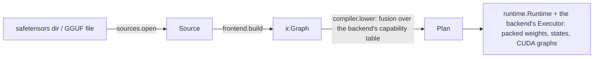

# warpc

An experimental compiler for decoder-only language models. It reads a Hugging Face safetensors checkpoint or a GGUF
file, builds a graph, fuses it into the kernels a backend declares it can run, and replays the result as CUDA graphs.
It shares no code with the hand engine (release tag v0.12.0, no longer in the tree); it is how this repository explores
models beyond the one that engine was written for.



Measured results (speed, accuracy, memory) are in the [root README](../README.md#results) and, per feature with date,
hardware and baseline versions, in the [changelog](../CHANGELOG.md).

## Install and run

Needs an NVIDIA GPU, a CUDA toolkit with `nvcc` (kernels are built on first use and cached by source digest and GPU
architecture) and Python 3.12. From the repository root:

```bash
uv sync --all-packages
```

```python
import warpc

model = warpc.compile("Qwen3-0.6B-Q4_0.gguf", ctx_max=4096)  # or an HF checkpoint directory
tokens = model.generate([785, 6722, 315, 9625, 374], max_new_tokens=24)
```

Token ids in, token ids out (no tokenizer). `append`, `step`, `decode`, `logits` and `reset` give step-level control;
`snapshot`, `restore`, `kv_export` and `kv_import` save and move state. `compile(..., kv=..., backend=...)` picks the KV
format and the backend (default `CudaBackend()`); `help(warpc.compile)` documents the rest.

## Scope

- Families and tested models: the [supported-models section of the root README](../README.md#supported-models).
- Checkpoints: float safetensors, compressed-tensors W4G128 safetensors, GGUF. GGUF F32, F16, BF16, Q8_0, Q4_0 and Q4_1
  are decoded by warpc, bit-identical to ggml; other non-IQ block formats go through the `gguf` package; IQ formats are
  rejected.
- KV cache: `bf16`, `k8v8`, `k8v8w`, `k8v4w`, `int4_rot` (the hand engine's rotated 4-bit format) and `fp8` (the
  Qwen3.5 checkpoint's per-layer scales; swiftmk backend and reference only). Gemma 4 and Inkling: `bf16`.
- Backends: `CudaBackend` (warpc's own kernels), `SwiftmkBackend` (the hand engine's kernels through `libswiftmk.so`),
  `CompositeBackend` (two backends behind one table, each task run by its owner).
- Greedy decode of one sequence; prompt steps of up to 8 rows, or with `compile(window_rows=N)` (swiftmk backend,
  needs `warpc[prefill]`) windows of up to 4,096 rows.
- Qwen3.5 27B only: MTP speculative decoding (`compile(speculate=k)`, entry point `warpc/speculate.py`) and
  prefix-cached long-context agent loops (`warpc/prefix.py`, `warpc/tools/agentloop.py`).
- Kernels compile for the GPU present; the fusion cost model and the tuning assume an RTX 3090 (sm_86).

## Layout

`warpc/src/warpc/`:

| Path | Role |
|---|---|
| `sources/` | `open(path)`: safetensors and GGUF readers behind one `Source` (HF tensor names, `ModelConfig`); MTP head requantiser |
| `frontend/` | `Source` to `ir.Graph`, one module per family over shared helpers |
| `ir/` | the graph and its op vocabulary |
| `reference.py` | pure-torch interpreter of a graph, the test oracle |
| `kvcache.py` | KV formats: sizes and reference quantisation |
| `compiler/` | target-independent: the fusion pass over a capability table, lowering to a `Plan`, the `Backend` protocol |
| `runtime.py` | `Runtime`: buffers, states, CUDA graphs, position and token feedback; the `Executor` protocol |
| `cuda/` | the CUDA backend: capability table, executor, kernels (`cuda/kernels/`, `cuda/inkling/`) |
| `swiftmk/` | the `swiftmk` backend: ctypes binding of the hand engine's kernel library behind a capability table |
| `composite.py` | `CompositeBackend` |
| `model.py` | `compile()` and `Model` |
| `speculate.py`, `memory.py` | MTP `Speculator`; the pre-flight device-memory estimate |
| `prefix.py`, `windows.py`, `windowrt.py`, `pinned.py` | prefix cache, prefill segmentation, window prefill plan, exact-size pinned host memory |

`warpc/tools/`: measurement and gating scripts, each with `--help`: `bench.py` (decode speed of warpc, llama.cpp, vLLM
and the hand engine), `matrix.py` and `fetch.py` (the model matrix of `models.toml`), `check.py` (accuracy against
transformers or llama.cpp), `compare27.py` and `gate27.py` (Qwen3.5 27B against the hand engine), `gate_window.py`,
`ab.py`, `near_tie.py`, `mtp_long.py`, `agentloop.py`, `compare_hf.py`, `inkling_w4_config.py`; `legacy.py` is the
helper that locates the legacy checkout. For example:

```bash
uv run --package warpc python warpc/tools/bench.py --help
```

## Tests

Each `warpc/tests/test_*.py` is a plain script run from the repository root; a test whose prerequisite (GPU, variable
below) is missing prints `skip` with the reason.

```bash
uv run --package warpc python warpc/tests/test_compiler.py   # CPU
uv run --package warpc python warpc/tests/test_cuda.py       # GPU and nvcc
```

CPU only: `test_sources`, `test_frontend`, `test_compiler`, `test_composite`, `test_prefix`, `test_windows`. The rest
need a GPU; the kernel-family tests (`test_hybrid`, `test_w4`, `test_deltanet`, `test_attn_gated`, `test_head_refine`,
`test_inkling_*`, `test_gemma4_*`) compare each kernel with its reference or with the hand kernel.

| Variable | Effect |
|---|---|
| `NVCC`, `CUDA_HOME` | where nvcc is (default: `nvcc` on `PATH`) |
| `WARPC_CACHE_DIR` | kernel build cache (default `$XDG_CACHE_HOME/warpc`, else `~/.cache/warpc`) |
| `WARPC_LEGACY_DIR` | a checkout of release tag v0.12.0 (the legacy 27B engine and server): the hand-engine oracles of the tests and the `gate27`, `compare27`, `gate_window`, `agentloop` and `swift_worker` tools, and the prompt corpus `engine/src/*.cu`; tests that need it skip without it |
| `WARPC_SWIFTMK_LIB` | `libswiftmk.so` built from that checkout (`$WARPC_LEGACY_DIR/engine/build/libswiftmk.so`): the `swiftmk` backend, its tests and the engine-comparison tests |
| `WARPC_TEST_GGUF` | a GGUF file: enables the real-file tests |
| `LLAMA_CPP_DIR` | a llama.cpp checkout: enables the ggml bit-identity test |
| `WARPC_TEST_SWIFT27` | the Qwen3.5 27B checkpoint directory: enables the 27B graph, lowering, MTP and agent-loop tests |
| `WARPC_TEST_GEMMA4` | a Gemma 4 E2B text checkpoint directory |
| `WARPC_TEST_INKLING` | the Inkling-2-Mini W4G128 directory (with the `config.json` that `tools/inkling_w4_config.py` writes) |
| `WARPC_INKLING_REF_PYTHON` | python (or venv) with transformers' official `inkling2_loop`: the tiny-model oracle `tests/oracle/inkling_hf.py` |
| `WARPC_INKLING_QUALITY`, `WARPC_DN_TRACE`, `WARPC_W4_SPEED`, `WARPC_ATTN_SPEED`, `WARPC_HEAD_SPEED` | optional extras of single tests; see the test's docstring |
| `WARPC_MODELS`, `LLAMA_SERVER` | tools: the model directory of `matrix.py` / `fetch.py`; the `llama-server` binary when not on `PATH` |

### The legacy checkout

The 27B hand engine and its server were removed from `main`; they live at release tag v0.12.0. Everything in warpc that
compares with them (the `swiftmk` backend's library, the hand `Engine`, `SpecEngine`, `FastPrefill` and `Runner`
oracles, the prompt corpus `engine/src/*.cu`) reads an external checkout named by `WARPC_LEGACY_DIR`, through
`tools/legacy.py`; nothing falls back to a copy in the tree. Get it with `git worktree add ../qwen-warp-legacy v0.12.0`,
then follow that tag's README to build `engine/build/libswiftmk.so` (`make engine` in the checkout) and export
`WARPC_LEGACY_DIR=../qwen-warp-legacy` and `WARPC_SWIFTMK_LIB=$WARPC_LEGACY_DIR/engine/build/libswiftmk.so`.

## Limits that follow from the design

- Weight shapes: bf16 and Q6_K linears need K a multiple of 256, Q4_0 and Q4_1 linears K a multiple of 512; head dim 64,
  128 or 256 (Gemma 4 also 512), at most 8 query heads per KV head. A model outside the kernels' limits fails at lowering
  with the limit named.
- The swiftmk backend carries the hand kernels' limits (Qwen3.5 27B shapes only); its library is refused when its
  workspace and KV size queries disagree with the layouts the binding was written against.
- MTP speculative decoding is greedy; its cycles equal the hand engine's bitwise after an 8-row prefill (after a window
  prefill the head's KV rows differ), but not warpc's own plain decode: a verify row is computed inside a (k + 1)-row
  step, the hand kernels' rounding depends on the row count, and a near-tie can flip. k = 1 equals plain decode only
  while a T = 2 step attends the same keys with the same split geometry as a T = 1 step. `decoder.k = 0` is plain decode.
- A window prefill's bits depend on its chunks, so `PrefixCache` snapshots only at the ends of `plan_windows(ids)` and
  resumes only where the recorded plan equals the new prompt's: a resumed turn is bit-equal to a cold prefill.
  `PrefixCache(exact=False)` gives that up to append to a lineage.
- `compile` estimates device memory before allocating and raises `ValueError` for a context that cannot fit;
  `host_tables=True` keeps the embedding and rescoring head in pinned host memory.
